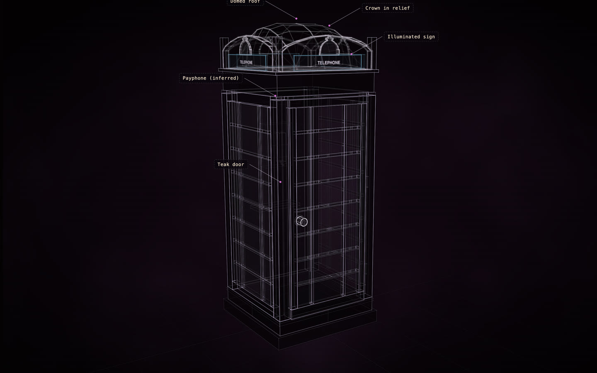

# K6 telephone kiosk

[](https://rtmandreyev.github.io/construct/examples/k6-telephone-kiosk/)

**fast · DeepSeek V4.1 Flash, with a provenance pass**

[Open the live construct](https://rtmandreyev.github.io/construct/examples/k6-telephone-kiosk/): drag to orbit, R replays the assembly, L shows
labels. The scene it was built from: [scene.json](scene.json).

Build it yourself from a checkout of Construct:

```sh
python3 construct_hologram/cli.py build examples/k6-telephone-kiosk/scene.json --out out/k6-telephone-kiosk
```

Its kit-ready copy and kit plan are in [kit/](kit/), its finish in [maps/finish.json](maps/finish.json). Every step
from the request to the kit: [The K6 telephone box, end to end](../../docs/WORKFLOW-K6.md).
