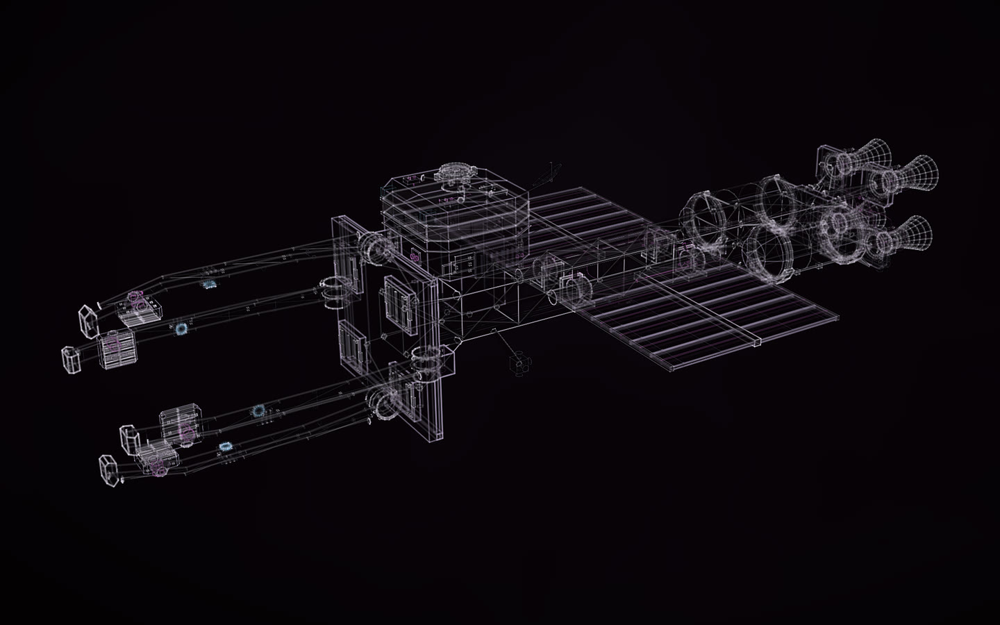

# KESTREL, more detailed

[](https://rtmandreyev.github.io/construct/examples/kestrel-v2/)

**masterpiece · GPT-6.1 Sol, in Codex**

[Open the live construct](https://rtmandreyev.github.io/construct/examples/kestrel-v2/): drag to orbit, R replays the assembly, P
shows how each part is known, S shows it as a solid; its views include close-ups of the roof dock, the aft cab, a
floodlight, a tank valve, an engine bell and the inspection carriage. The scene: [scene.json](scene.json).

[KESTREL](../kestrel/), asked for again with more detail for close-ups, on the rule that keeps a design usable
while it changes: keep every part's name, place and size, and add detail as new parts. All 256 parts of KESTREL are
here unchanged, in their order, with 242 new ones (their names start with `v2-`): 498 parts in all, 1,023 copies
with the repeats and mirrors counted. The ship's size, its origin, its docking port and its six joints are the
same, so whatever names a part of KESTREL (an animation, a Godot scene, a game's script) still finds it; the new
hardware on the arms and wings rides the same hinges. Six masterpiece rounds, the best round 6, stopped with every
criterion at 3; round 3 lost to round 2 and was reverted. It needs Construct 1.2 or newer, which allows 1,024
parts a scene (1.1 allowed 256). [New things from real ones →](../../docs/for/invent-from-what-exists.md#6-more-detail-every-part-kept)

What was added: pressure seals on the glazing, hinges and catches on the hatches, a recessed handwheel, stud heads on
the docking flange; serpentine coolant circuits on all twelve radiator panels and fasteners, collars and service
couplings at their rotary joints; weld beads, band studs, valve wheels and sensor housings on the tanks; cooling
channels on the engine bells and controller cassettes beside them; cooling fins, bezels with four captive screws,
glands and strain-relief loops on the floodlights. Every one is designed, like the rest of the ship.

## How it was made

| | |
| --- | --- |
| Agent | Codex CLI 0.166.0-alpha.5.1, the copy inside the ChatGPT app for macOS, with approvals off in a folder of its own |
| Model | GPT-6.1 Sol, reasoning effort high (author and every critic) |
| Construct | `main` after the part-cap change (commit b49830c: up to 1,024 parts), as a project skill |
| Mode | masterpiece |
| Rounds | 6, 21.5 active minutes and 25.1 critic minutes; the session took about 50 minutes |

The brief (`BRIEF4.txt`), as sent:

```text
Make the final KESTREL (KESTREL-final/) more detailed for close-ups. Keep every part's name, place and size; add detail as new parts. Masterpiece mode. Put the new version in KESTREL-final-v2/ beside it, with the same deliverables (construct, glTF for Godot, NOTES.md), and say how many parts were kept and how many added.
```

The earlier briefs, and the record of the first build and its continuation, are in [KESTREL's README](../kestrel/).

## Build it

From a checkout of Construct:

```sh
python3 construct_hologram/cli.py build examples/kestrel-v2/scene.json --out out/kestrel-v2
python3 construct_hologram/cli.py export examples/kestrel-v2/scene.json --out kestrel-v2.glb   # 498 named parts, six joints
python3 construct_hologram/cli.py export examples/kestrel-v2/scene.json --out kestrel-v2-finished.glb --materials examples/kestrel/maps/finish.json   # finished, for Blender (one map for both versions)
```

Apache-2.0, like the rest of Construct.
