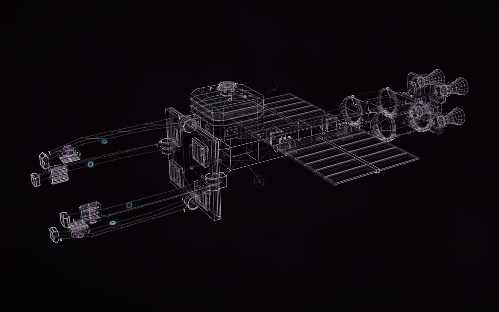

# KESTREL, an invented ice tug

[](https://rtmandreyev.github.io/construct/examples/kestrel/)

**masterpiece · GPT-6.1 Sol, in Codex**

[Open the live construct](https://rtmandreyev.github.io/construct/examples/kestrel/): drag to orbit, R replays the assembly (the
cradle arms open and the radiator wings fold after it), P shows how each part is known, S shows it as a solid. The
scene it was built from: [scene.json](scene.json); its finish for Blender: [maps/finish.json](maps/finish.json)
([in Blender](../../docs/for/invent-from-what-exists.md#take-it-further-a-finish-in-blender)). The same ship with more
detail and every part kept: [KESTREL, more detailed](../kestrel-v2/).

A crewed tug, about 120 m long, that pushes blocks of water ice from a planet's rings to a refinery, designed for a
game from one brief. It does not exist: every part is designed, none measured, and **P** shows them all so. What
grounds it is reasoning borrowed from real studies, cited in the scene: NASA's reusable Space Tug study,
[NASA-CR-114938](https://ntrs.nasa.gov/citations/19710011980) (1971), for separable crew, service and propulsion
functions; the International Space Station's [integrated truss](https://www.nasa.gov/image-article/integrated-truss-structure-diagram/)
for a spine that carries attachment points and utility runs; and
[Thermal Radiator Pointing for the ISS](https://ntrs.nasa.gov/citations/20000032541) (NTRS 20000032541) for
radiators turned edge-on to what heats them. Nothing of those vehicles is copied.

256 named parts, 13 masterpiece rounds, the best round 13, stopped with every criterion at 3. Four cradle arms
release by 32° and two radiator wings fold by 78° (six joints); the four floodlights on the arms blink on a
4.8-second cycle. The whole story, from the brief to the Godot scene: [New things from real ones →](../../docs/for/invent-from-what-exists.md)

## How it was made

| | |
| --- | --- |
| Agent | Codex CLI 0.166.0-alpha.5.1, the copy inside the ChatGPT app for macOS, with approvals off in a folder of its own |
| Model | GPT-6.1 Sol, reasoning effort high (author and every critic) |
| Construct | 1.1.1, as a project skill (`.agents/skills/construct`; the folder's `AGENTS.md` pointed Codex to it) |
| Mode | masterpiece; the continuation (the third brief) lifted the round and time caps |
| Rounds | 1 to 4: the first build, 9.2 active minutes and 11.7 critic minutes, stopped with every criterion at 3. 5 to 13: the continuation, 32.6 active minutes and 49.8 critic minutes in all, stopped the same way |
| Frame | metres, +Y up, the bow towards +Z, the origin at the cradle's centre. The roof docking port's mating plane is centred at (0, 18, −25) m, its axis (0, 1, 0) |

The briefs, in order, as sent. The first is the invented brief that this repository's guide to
[new things from real ones](../../docs/for/invent-from-what-exists.md) used to give as an illustration.

**1. The first build** (`BRIEF.txt`; 28 minutes; 254 parts, 4 rounds):

```text
Using the construct skill, make a masterpiece construct of KESTREL, an ice tug for my game: a crewed tug that pushes blocks of water ice from a planet's rings to a refinery. Masterpiece mode.

- Lay it out the way real spacecraft studies would: a pusher with the crew at the opposite end from the engines, a long truss between them, radiators edge-on to the engines, the cargo held in a cradle the tug pushes. Borrow reasoning from NASA's space tug studies and the ISS truss and radiators; copy nothing.
- About 120 m long with an empty cradle; metres; Y up; the bow towards +Z; origin at the cradle's centre.
- It must have: a two-deck crew cab with a wide window band; a docking port on the cab's roof; a cradle of four arms that close around a block; two radiator wings; a cluster of four engines; floodlights on the cradle arms.
- Design whatever else it needs to work (propellant tanks, attitude thrusters, antennas), and give every part a job.
- The cradle arms open and close, and the radiator wings fold (joints). The floodlights blink slowly (motion).
- No text or labels in the geometry. Use tone slots, not fixed colours. Nothing random from run to run.
- Deliver the construct, a glTF for Godot, a 16-second review film, and NOTES.md with the sizes, the frame and where the docking port is (its centre and its axis).
```

**2. More detail on the first build** (`BRIEF2.txt`; 23 minutes; 254 parts kept, 234 added, 3 rounds). Not
published here: it was the trial of the request that [KESTREL, more detailed](../kestrel-v2/) repeats on this
version, and at 488 parts it needed a local wrapper around the 256-part cap of the time.

```text
Make KESTREL more detailed for close-ups. Keep every part's name, place and size; add detail as new parts. Masterpiece mode. Put the new version in KESTREL-v2/ beside the first, with the same deliverables (construct, glTF for Godot, NOTES.md), and say how many parts were kept and how many added.
```

**3. The continuation, this version** (`BRIEF3.txt`; about an hour; rounds 5 to 13, 256 parts):

```text
Continue the masterpiece run of KESTREL (the brief is in BRIEF.txt; the run so far is run-47b2, with its rounds.md, ledger and checkpoints, and the delivered version in KESTREL/). The goal is a ship that stands with the best constructs Construct has made, such as the Nissan Skyline GT-R R34, the Sainte-Chapelle and ARGUS in its gallery. Keep running critic rounds from the best version so far, as many as it takes: do not stop at the default round or time caps while the critic still finds a better version. Keep the brief's reasoning (NASA space-tug studies, the ISS truss and radiators, copy nothing), give every part a job, keep the working joints (the cradle arms open and close, the radiator wings fold) and the floodlights' slow blink. Record every round in the same run (rounds.md, ledger, checkpoints). When it is done, deliver the best version in KESTREL-final/ with the same deliverables as before (construct, glTF for Godot, a 16-second review film, NOTES.md) and a short summary of what changed since KESTREL/.
```

ARGUS, named in the third brief, was a construct made for a film and then in the gallery; it is no longer published.

**4. More detail on this version:** the brief behind [KESTREL, more detailed](../kestrel-v2/).

The run's own record (its rounds, ledger, critic packets, checkpoints, Godot project and film) is kept outside the
repository; the scene carries its sources, facts and round history.

**A post-run correction, made for Construct 1.2:** the scene's `subject.accuracy` is now `"original"`, so its
subtitle reads ORIGINAL DESIGN. The run predated that class: it recorded `"generic"`, captioned GENERIC
RECONSTRUCTION, and added a line to *How to read it* explaining the caption, which is removed. Nothing else in the
scene changed; because the scene did, `check` says its critic judged another version (`critic-stale`).

## Build it

From a checkout of Construct:

```sh
python3 construct_hologram/cli.py build examples/kestrel/scene.json --out out/kestrel
python3 construct_hologram/cli.py export examples/kestrel/scene.json --out kestrel.glb   # named parts, six joints, for Godot or Blender
python3 construct_hologram/cli.py export examples/kestrel/scene.json --out kestrel-glued.glb --pieces glued   # for Godot: glued pieces, hinged arms and wings
python3 construct_hologram/cli.py export examples/kestrel/scene.json --out kestrel-finished.glb --materials examples/kestrel/maps/finish.json   # finished, for Blender
```

Apache-2.0, like the rest of Construct. KESTREL is a design for a game, not an engineering study: no thrust, mass,
power or flight performance is claimed.
