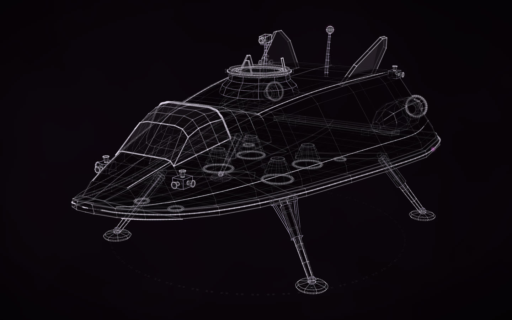
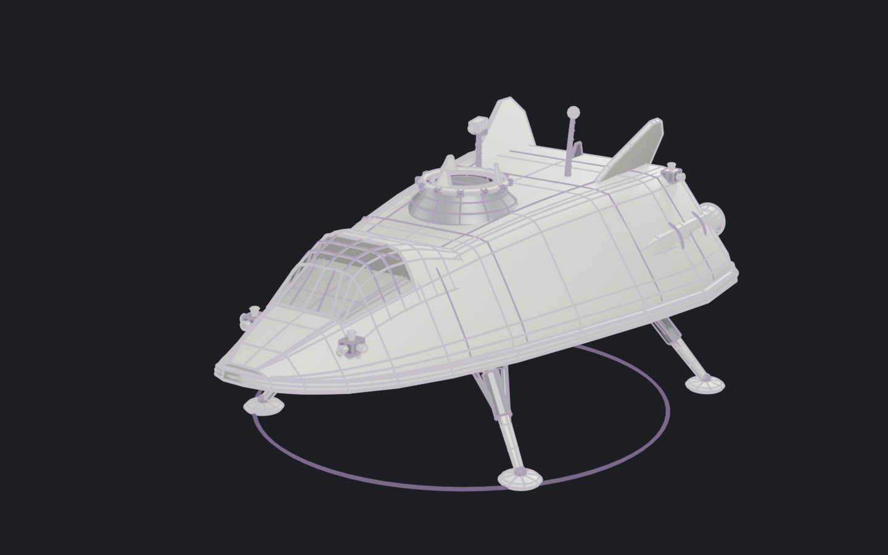

# Lander 2

**masterpiece · Claude Opus 5.5**

ARGUS's crewed lander: a wedge lifting body on a heat-shield belly, four folding legs, a glazed flight deck and a docking collar on its back. The ship was built around it, carrying this lander's own construct at its docking port, so the two always match.

[Open the live construct](https://rtmandreyev.github.io/construct/examples/lander-2/): drag to orbit, R replays the assembly, P shows every part as
designed (none is measured: it does not exist), S shows it as a solid.

The film's Blender model, rendered in a plain studio.

Made for the author's visual album film. How to design something like it, with a brief of your own:
[New things from real ones](../../docs/for/invent-from-what-exists.md).

**Not published:** the scene and the brief it was made from. **Rights:** all rights reserved, to view only;
not under Construct's Apache-2.0 licence ([LICENSE](LICENSE)).
