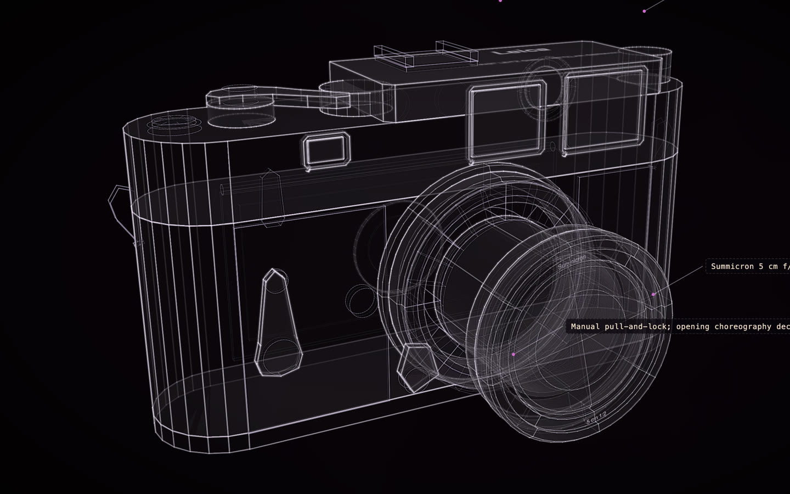

# Leica M3

[](https://rtmandreyev.github.io/construct/examples/leica-m3/)

**fast · GPT-6.1 Sol**

[Open the live construct](https://rtmandreyev.github.io/construct/examples/leica-m3/): drag to orbit, R replays the assembly, L shows
labels. The scene it was built from: [scene.json](scene.json).

**Revised after the run.** Three slips fixed in 1.2.1. The lens's name ring was a full disc: in the solid view it
capped the front element like a lens cap, and its inscription ran across the front lip, cut in two by it. It is now a
ring on the front head's recessed step, inscribed *Summicron* above and *5 cm 1:2* below, so the glass shows and the
words sit on metal. The ASA/DIN film reminder on the back read upside down; it is turned upright. The vulcanite
panels ran 15 mm past the flat front, out into the air beside the body's rounded ends; they now stop where the flat
front stops. An independent critic judged the revised scene; its answer is recorded in the scene.

Build it yourself from a checkout of Construct:

```sh
python3 construct_hologram/cli.py build examples/leica-m3/scene.json --out out/leica-m3
```
