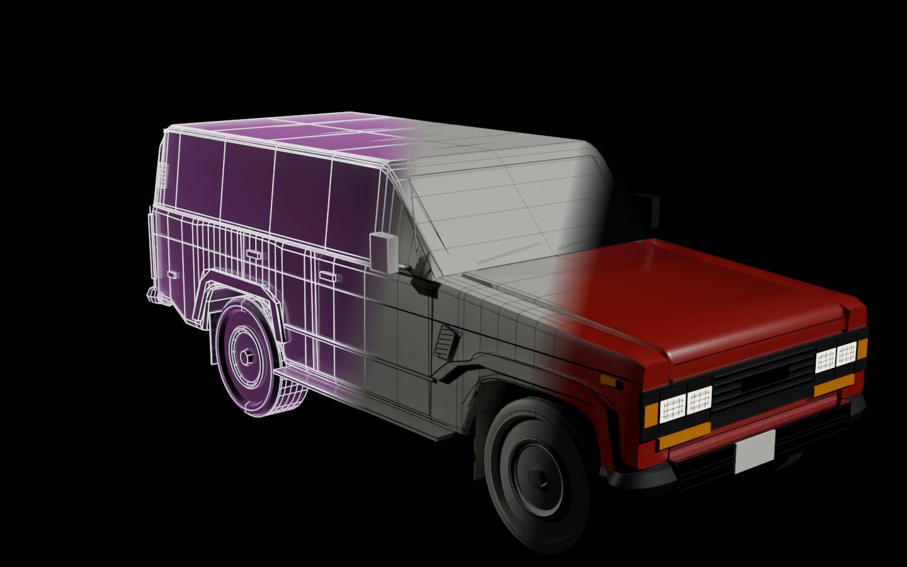

# From light to a finished model

**[See the four models in 3D →](https://rtmandreyev.github.io/construct/examples/light-to-metal/)**

Every construct is also a 3D model. What an agent writes (named parts in metres, joints, the
order they assemble in) exports as one glTF file with `construct export`, and a material map
finishes it. This page shows four gallery constructs as those files, lit live, from the hologram
to the plain model to the finished one:

- the **Toyota Land Cruiser FJ62** (masterpiece, Claude Opus 5.5), with a tailgate that opens;
- the **James Webb Space Telescope** (masterpiece, DeepSeek V4.1 Flash);
- the **Revox A77** (fast, DeepSeek V4.1 Flash), its reels turning;
- the **Arturia MiniFreak** (fast, DeepSeek V4.1 Flash): its 37 keys, 16 step buttons and two touch
  strips match Arturia's manual, and its width and height Arturia's specifications.

On the page:

- **Light ↔ Metal** sweeps a scan line up the model: below it the solid model, its lines as dark
  seams; above it the hologram, lines of light over dark glass.
- **Plain ↔ Finished** turns the plain model (clay) into the finished one: paint, chrome, glass,
  brushed metal, rubber, lamps. As the model turns solid, the construction lines (the edges of each
  part's surfaces) fade, and only the design lines stay as seams: doors, creases, outlines.
- **Build** replays the assembly from each vertex's build phase, with its bright front.
- **Open** plays the model's own joints, from the file's `open` animation.
- **Explode** takes the model apart into its named parts; hover a part to read its name, role,
  certainty and size.
- **Certainty** colours each part by how it is known (verified, supplied by you, inferred,
  decorative), and **Play** runs the whole story.

## How it was made

1. **The constructs** are the gallery's own, unchanged (`examples/toyota-land-cruiser-fj62`,
   `examples/films/james-webb-space-telescope`, `examples/revox-a77`, `examples/arturia-minifreak`).
2. **The finishes** are material maps in `maps/`, one per construct, chosen for this page from
   photographs and listings (the FJ62 in Freeborn Red, a factory colour of the 60 Series, with
   chrome bumpers; the Revox in the Mk I's silver front with black knobs; the telescope's gold
   mirror and silver-violet sunshield; the MiniFreak in black). Colours are the exporter's choice,
   kept beside the constructs, never facts in them.
3. **The files.** The site build exports each one with `construct export scene.json --out
   name.glb --materials maps/name.json` (line art as edges, closed pose), unedited. The `.glb`
   files are not in the repository; the build writes them beside the page.
4. **The page** (`index.html`) loads them with three.js 0.160's glTF loader and draws them with its
   own shaders: the surfaces blend from clay to their exported materials, the scan line and build
   front read each vertex's `_PHASE` and height, the joints play the file's `open` clip, and the
   motion its `idle` clip. Nothing is changed in the geometry.
5. **The picture above** is a Blender 5.2 render (Cycles) of the FJ62, imported with the
   [Construct add-on](../../hosts/blender/README.md) and its material map: three renders from the
   same camera (the hologram, the plain model, the finished one) blended along two diagonals.

The page loads three.js 0.160.0 from cdn.jsdelivr.net and its fonts (Instrument Serif, IBM Plex
Mono) from Google Fonts, so it needs an internet connection; to open it from disk, build the site
(`python3 scripts/build_site.py --out site --no-films`) and serve `site/` with any static server.

**What the models are, honestly:** correctly sized named parts with working joints, built from
Construct's own shapes, without textures (Blender adds procedural wood and brushed metal); parts
are not merged. A blockout, a prop or a teaching model, not a finished hero asset. See
[3D export](../../docs/EXPORT.md).
