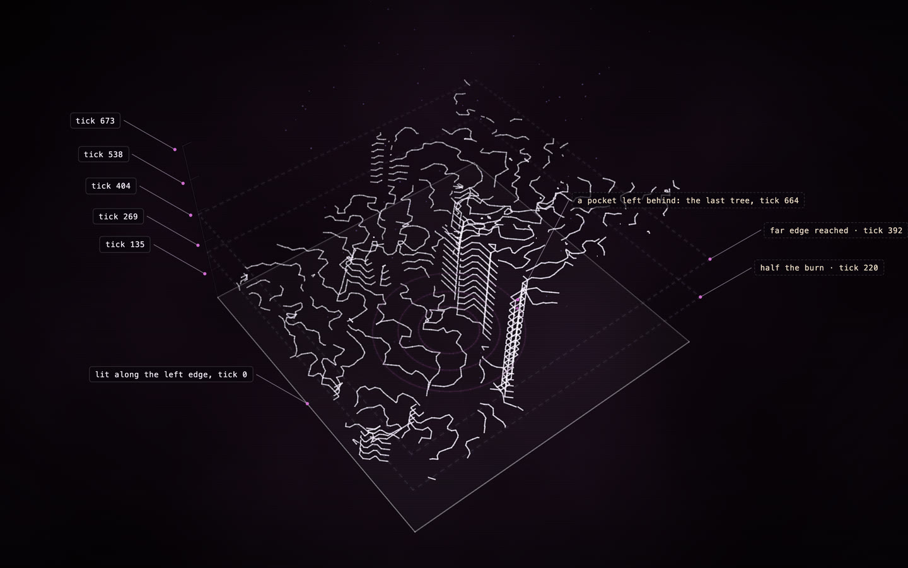

# Fire, recorded

**[Open the construct →](https://rtmandreyev.github.io/construct/examples/netlogo-fire/)**

One run of NetLogo's **Fire** model, recorded with Construct's NetLogo bridge and drawn as a construct
(the field view). The fire's front, every 26 ticks, raised to its tick: it starts at the left edge and climbs as it crosses the forest. Where a pocket burned long after its surroundings, the fronts stack into a ladder; where nothing burned, nothing is drawn.

**Credit:** *Fire* © 1997 Uri Wilensky, NetLogo Models Library: Wilensky, U. (1997). NetLogo Fire model. http://ccl.northwestern.edu/netlogo/models/Fire. Center for Connected Learning and Computer-Based Modeling, Northwestern University, Evanston, IL. Licensed under
[CC BY-NC-SA 3.0](https://creativecommons.org/licenses/by-nc-sa/3.0/); so is this folder (see
[LICENSE](LICENSE)).

## How it was made

The data is computed from the recorded run, never drawn by a model. An AI art-direction pass (Claude Opus 5.5) then added the labels and milestones on top, and a data lock keeps it off the data.

1. **Instrumented** with `construct netlogo-instrument "Fire.nlogox" --title "Fire" --out . --patches pcolor:4 --no-turtles --seed 3 --ticks 1000`,
   which adds `__includes ["construct.nls"]`, the recording after setup's `reset-ticks` and after
   go's `tick`, and a headless experiment. The model's own rules are unchanged.
2. **Run** in NetLogo 7.0.4, headless, with random-seed 3 and density 61%:
   `NetLogo_Console --headless --model "Fire-construct.nlogox" --setup-file construct-experiment.xml --experiment construct --threads 1`.
   Construct's recorder wrote every patch's colour every 4 ticks to `run.jsonl` (not kept here: the run reproduces it).
3. **Drawn** with `construct netlogo run.jsonl --view field --levels 24 --title "Fire (NetLogo)" --art art.json --out scene.json`: blocks of 4 x 4 patches, each the earliest burn among its trees. Every data part
   is verified against the recording, and the build rises from the floor, so the construct's
   assembly replays the run.

4. **Art-directed** by Claude Opus 5.5 in [`art.json`](art.json): rings where half the burn was done (tick 220) and where the front reached the far edge (tick 392), the last tree to catch (tick 664, in a pocket the front left behind), the tick numbers and three views. In all, 76.8% of the trees burned. Each milestone was computed from `run.jsonl` by a short script and is marked `inferred`, with how in its note. The scene's `data_lock` fact makes `construct check` refuse any change to the data under it.

See [the NetLogo bridge](../../docs/NETLOGO.md).
