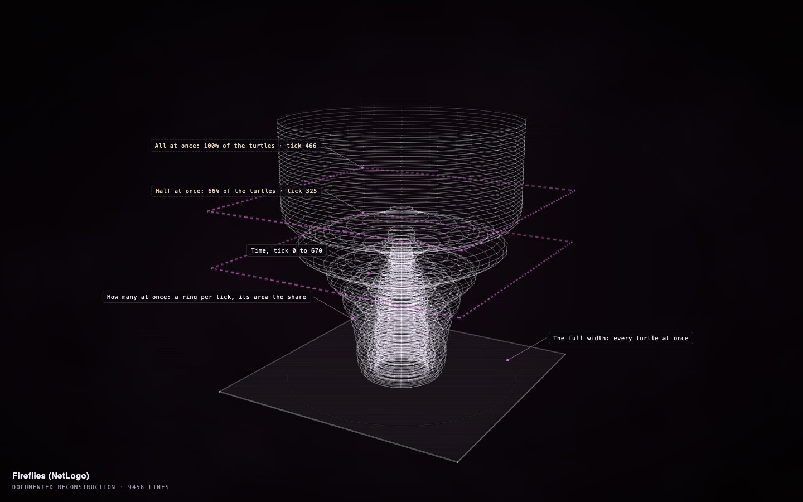
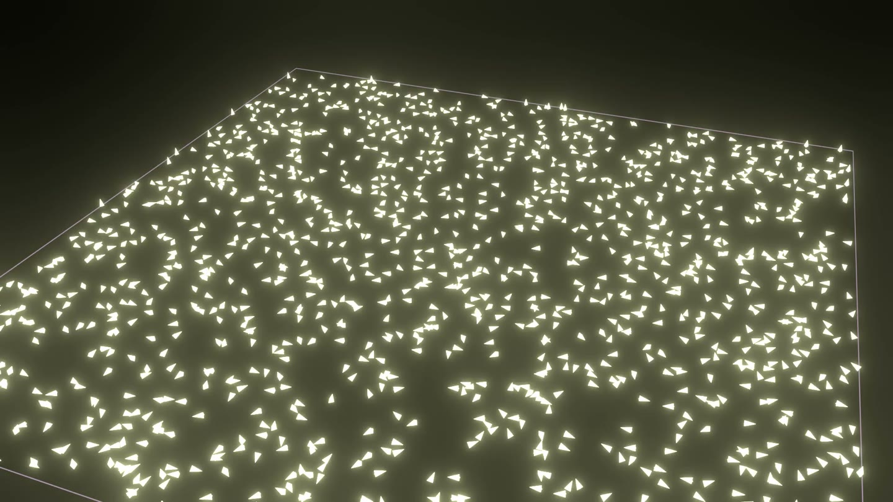

# Fireflies: falling into step

**[Open the construct →](https://rtmandreyev.github.io/construct/examples/netlogo-fireflies/)**

One run of NetLogo's **Fireflies**, in which each firefly flashes on its own clock and resets it when
it sees a neighbour flash. Construct's **pulse** view draws one ring for each tick, as wide as the number
of fireflies flashing then: a thin, ragged column while they flash on their own, opening into wide
plates once the whole swarm flashes together. It is drawn over the window where that happened, ticks
0 to 670 of 2000, and its landmarks are the first tick half the swarm flashed at once (tick 325) and the
first tick all of it did (tick 466).

The same run as a film in Blender (`construct netlogo-film`): every firefly at every tick, here at a
moment when the whole swarm flashes.

**Credit:** *Fireflies* © 1997 Uri Wilensky, NetLogo Models Library: Wilensky, U. (1997). NetLogo Fireflies model. http://ccl.northwestern.edu/netlogo/models/Fireflies. Center for Connected Learning and Computer-Based Modeling, Northwestern University, Evanston, IL. Licensed under
[CC BY-NC-SA 3.0](https://creativecommons.org/licenses/by-nc-sa/3.0/); so is this folder (see [LICENSE](LICENSE)).

## How it was made

1. The stock model with `extensions [construct]` added
   ([`Fireflies-construct.nlogox`](Fireflies-construct.nlogox)); its rules are unchanged.
2. In NetLogo 7.0.4: `random-seed 5`, then `construct:run-for 2000` (the model never stops by
   itself). The view (`pulse`), the window (where the synchrony formed) and the landmarks were chosen
   from the recording; `--window whole` would draw all 2000 ticks.
3. The film: `construct netlogo-film fireflies-run.jsonl --out film.mp4 --trail 0`, rendered in Blender.

See [the NetLogo bridge](../../docs/NETLOGO.md).
