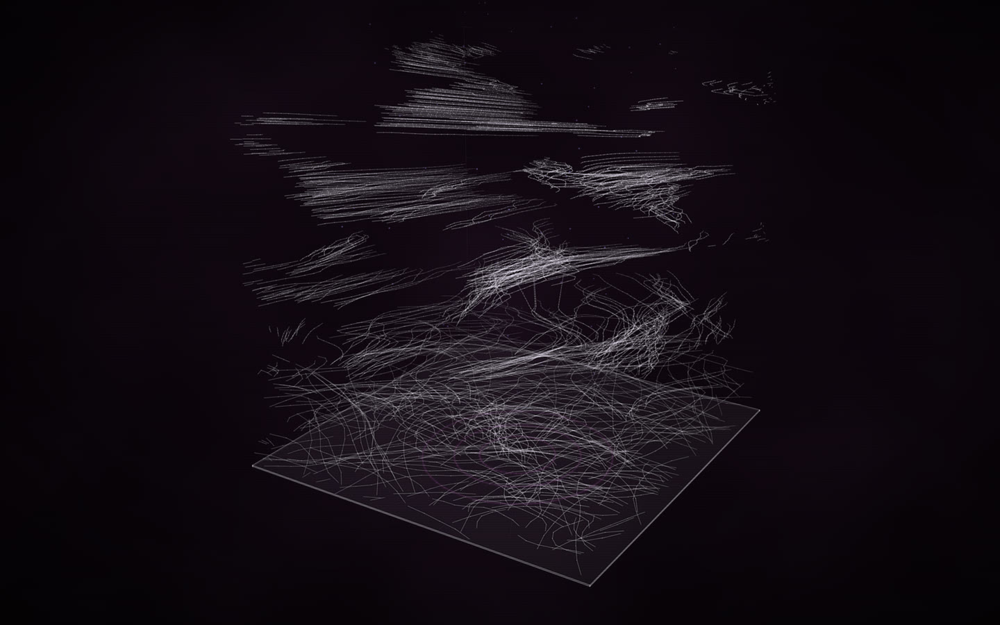

# Flocking, recorded

**[Open the construct →](https://rtmandreyev.github.io/construct/examples/netlogo-flocking/)**

One run of NetLogo's **Flocking** model, recorded with Construct's NetLogo bridge and drawn as a construct
(the space-time view). Each bird's track rises with time: the floor is the world, height is ticks. Near the floor the birds fly at random; higher up they have found each other, and the tracks run in parallel streams: flocks.

**Credit:** *Flocking* © 1998 Uri Wilensky, NetLogo Models Library: Wilensky, U. (1998). NetLogo Flocking model. http://ccl.northwestern.edu/netlogo/models/Flocking. Center for Connected Learning and Computer-Based Modeling, Northwestern University, Evanston, IL. Licensed under
[CC BY-NC-SA 3.0](https://creativecommons.org/licenses/by-nc-sa/3.0/); so is this folder (see
[LICENSE](LICENSE)).

## How it was made

No model and no agent drew this: the construct is computed from the recorded run.

1. **Instrumented** with `construct netlogo-instrument "Flocking.nlogox" --title "Flocking" --out . --turtles heading --seed 7 --ticks 300`,
   which adds `__includes ["construct.nls"]`, the recording after setup's `reset-ticks` and after
   go's `tick`, and a headless experiment. The model's own rules are unchanged.
2. **Run** in NetLogo 7.0.4, headless, with random-seed 7 and the model's defaults (300 birds):
   `NetLogo_Console --headless --model "Flocking-construct.nlogox" --setup-file construct-experiment.xml --experiment construct --threads 1`.
   Construct's recorder wrote every bird each tick (who, position, colour, heading) to `run.jsonl` (not kept here: the run reproduces it).
3. **Drawn** with `construct netlogo run.jsonl --view space-time --out scene.json`: 150 of the 300 birds, chosen evenly by who. Every data part
   is verified against the recording, and the build rises from the floor, so the construct's
   assembly replays the run.

See [the NetLogo bridge](../../docs/NETLOGO.md).
