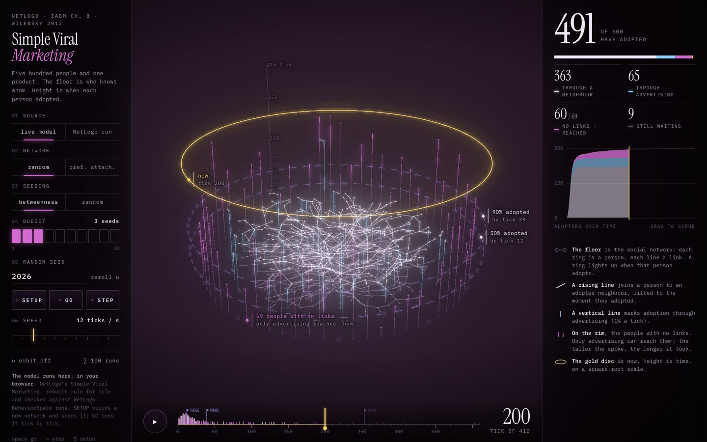

# Simple Viral Marketing, live

**[Open the live model →](https://rtmandreyev.github.io/construct/examples/netlogo-viral-marketing/)** · or
[the construct](https://rtmandreyev.github.io/construct/examples/netlogo-viral-marketing/construct.html)
of one NetLogo run

An example of what Construct can be used for beyond objects: NetLogo's **Simple Viral Marketing**
agent-based model, rebuilt to run live in the browser and drawn as a construct. Five hundred people
and one product: the floor is who knows whom, and height is when each person adopted. You can set
up a network, run it tick by tick, scrub the timeline, trace who convinced whom, and run it 100
times to compare with NetLogo's own BehaviorSpace results.

**Credit:** *Simple Viral Marketing* © 2012 Uri Wilensky, NetLogo Models Library (Wilensky, U. &
Rand, W., *An Introduction to Agent-Based Modeling*, MIT Press, 2015), licensed under
[CC BY-NC-SA 3.0](https://creativecommons.org/licenses/by-nc-sa/3.0/).

**License:** unlike the rest of Construct (MIT), **this folder is under CC BY-NC-SA 3.0**, because
everything in it derives from the model: the page, the port of the model, the NetLogo run and the
construct. See [LICENSE](LICENSE).

## How it was made

1. **NetLogo.** One run of the model in NetLogo 7.0.4 (random network, 500 people, betweenness
   seeding, budget 3, random-seed 2026), run through BehaviorSpace and exported: each person's
   adoption tick, its cause (seed, advertising or a neighbour) and the network as NetLogo laid it
   out. The decision rule is the library model's, unchanged. The export is `netlogo-run.js`.
2. **The construct.** That run, turned into exact polylines, was written into a Construct scene by
   DeepSeek V4.1 Flash, over check-and-repair and art-direction rounds (`scene.json`); Construct
   builds it into [construct.html](https://rtmandreyev.github.io/construct/examples/netlogo-viral-marketing/construct.html).
3. **The live page.** The model rebuilt rule for rule in JavaScript (`svm-model.js`), by Claude
   Opus 5.5, so it runs in the browser, and a page (`index.html`) that draws it in Construct's
   Measured Light style, tick by tick. The port uses its own random-number generator, so a seed
   here is not a NetLogo seed; over 100 runs per budget its mean times to 50, 90, 95 and 99%
   adoption came within 0 to 9 ticks of NetLogo's BehaviorSpace means, and full adoption within its
   wide run-to-run spread.

Unlike the other examples, the page is not a Construct page: it loads three.js 0.160.0 from
cdn.jsdelivr.net and its fonts (Instrument Serif, IBM Plex Mono) from Google Fonts, so it needs an
internet connection. It opens from any static host or straight from disk. URL options:
`?source=netlogo` (replay the NetLogo run), `?t=<tick>`, `?orbit=0`.

The "who convinced whom" line credits one adopted neighbour at random, a drawing choice: the
model's rule uses the share of adopted neighbours, not one person.
