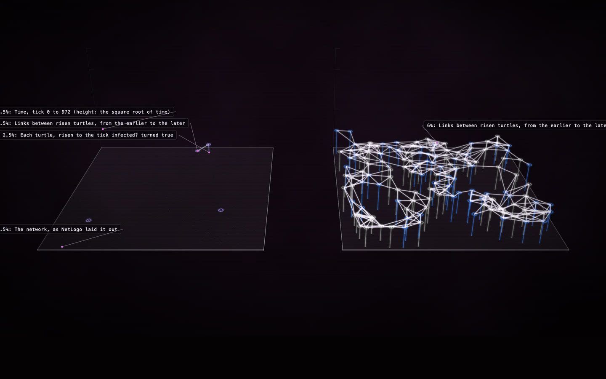

# Virus on a Network: two runs side by side

**[Open the construct →](https://rtmandreyev.github.io/construct/examples/netlogo-virus-compare/)**

The classroom question "what does one slider do?", answered with two runs of NetLogo's **Virus on a
Network**, the same seed, drawn the same way on one time scale. On the left the virus spreads with a
2.5% chance: it reaches 4 people and dies out after 10 ticks. On the right, at 6%, it reaches all 150 and
runs for 972 ticks.

**Credit:** *Virus on a Network* © 2008 Uri Wilensky, NetLogo Models Library: Stonedahl, F. and Wilensky, U. (2008). NetLogo Virus on a Network model. http://ccl.northwestern.edu/netlogo/models/VirusonaNetwork. Center for Connected Learning and Computer-Based Modeling, Northwestern University, Evanston, IL. Licensed under
[CC BY-NC-SA 3.0](https://creativecommons.org/licenses/by-nc-sa/3.0/); so is this folder (see [LICENSE](LICENSE)).

## How it was made

1. The stock model with `extensions [construct]` added
   ([`Virus-on-a-Network-construct.nlogox`](Virus-on-a-Network-construct.nlogox)).
2. Two runs in NetLogo 7.0.4, each with `random-seed 7`: `set virus-spread-chance 2.5` then `construct:run`,
   and `set virus-spread-chance 6` then `construct:run` (each run's recording renamed in between).
3. `construct netlogo-compare low.jsonl high.jsonl --labels "2.5%,6%" --out scene.json`: both runs on
   the longer run's time scale, every part, fact and count marked with its run, one data lock over both.

See [the NetLogo bridge](../../docs/NETLOGO.md) and [the classroom guide](../../docs/CLASSROOM.md).
