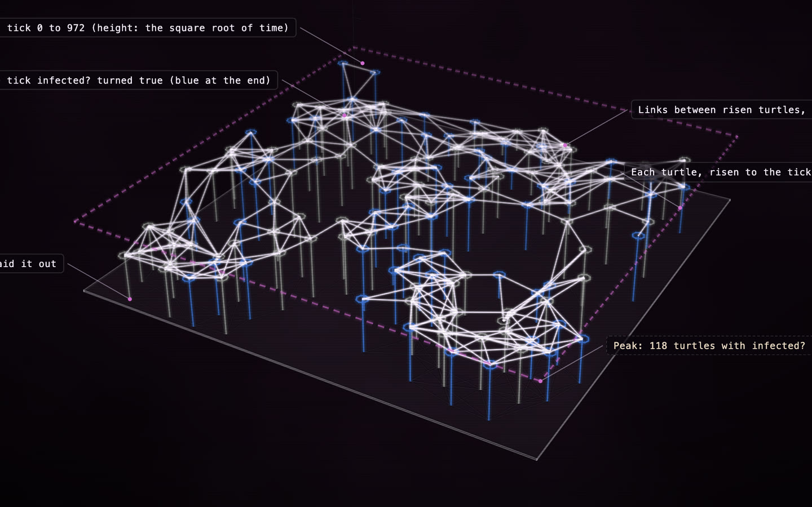

# Virus on a Network, in one command

**[Open the construct →](https://rtmandreyev.github.io/construct/examples/netlogo-virus-on-a-network/)**

One run of NetLogo's **Virus on a Network**, recorded and drawn by Construct's NetLogo extension with one
command, `construct:run`. The floor is the network as NetLogo laid it out; each person rises to the tick
they were first infected, and a link climbs from the earlier of its two people to the later. The dashed
frame is the run's peak, which Construct found by itself: 118 people infected at once, at tick 68.

**Credit:** *Virus on a Network* © 2008 Uri Wilensky, NetLogo Models Library: Stonedahl, F. and Wilensky, U. (2008). NetLogo Virus on a Network model. http://ccl.northwestern.edu/netlogo/models/VirusonaNetwork. Center for Connected Learning and Computer-Based Modeling, Northwestern University, Evanston, IL. Licensed under
[CC BY-NC-SA 3.0](https://creativecommons.org/licenses/by-nc-sa/3.0/); so is this folder (see [LICENSE](LICENSE)).

## How it was made

1. The stock model with one line added at the top of its code, `extensions [construct]`
   ([`Virus-on-a-Network-construct.nlogox`](Virus-on-a-Network-construct.nlogox)); its rules are unchanged.
2. In NetLogo 7.0.4's Command Center: `random-seed 7`, `set virus-spread-chance 6`, then
   `construct:run`. It pressed setup and go as the model's buttons do, recorded every person and link,
   let the run go until the model stopped by itself (tick 972) and chose the view the data suits
   (`network-time`: a network, and `infected?` turned true for all 150 people).
3. Nothing else: no art direction. The legend, How to read it, the replay bar with the counts, the
   peak landmark, Data (CSV), Cite this run and the printable worksheet (Cmd/Ctrl+P) all come from the
   recording, and a data lock keeps them true to it.

See [the NetLogo bridge](../../docs/NETLOGO.md) and [the classroom guide](../../docs/CLASSROOM.md).
