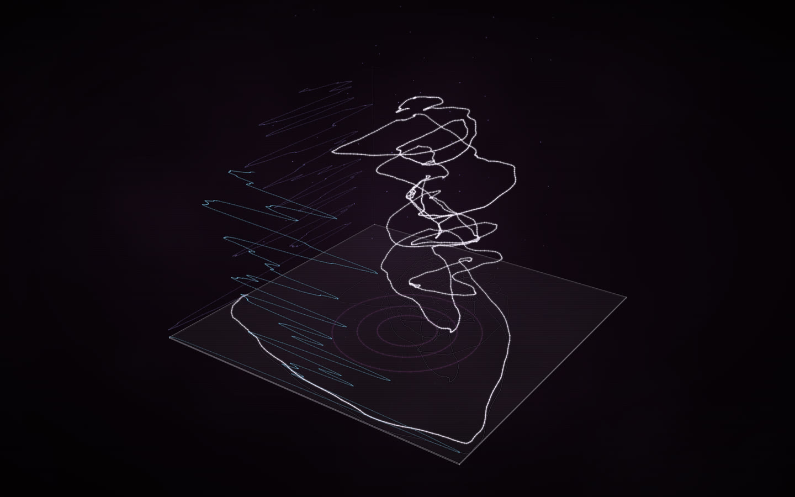

# Wolf Sheep Predation, recorded

**[Open the construct →](https://rtmandreyev.github.io/construct/examples/netlogo-wolf-sheep/)**

One run of NetLogo's **Wolf Sheep Predation** model, recorded with Construct's NetLogo bridge and drawn as a construct
(the phase view). The predator-prey cycle rising in time: across the floor the number of sheep, front to back the number of wolves, height is ticks. Its shadow on the floor is the classic phase plot; the walls carry each population against time.

**Credit:** *Wolf Sheep Predation* © 1997 Uri Wilensky, NetLogo Models Library: Wilensky, U. (1997). NetLogo Wolf Sheep Predation model. http://ccl.northwestern.edu/netlogo/models/WolfSheepPredation. Center for Connected Learning and Computer-Based Modeling, Northwestern University, Evanston, IL. Licensed under
[CC BY-NC-SA 3.0](https://creativecommons.org/licenses/by-nc-sa/3.0/); so is this folder (see
[LICENSE](LICENSE)).

## How it was made

No model and no agent drew this: the construct is computed from the recorded run.

1. **Instrumented** with `construct netlogo-instrument "Wolf Sheep Predation.nlogox" --title "Wolf Sheep Predation" --out . --reporters "count sheep;count wolves" --no-turtles --seed 11 --ticks 1500`,
   which adds `__includes ["construct.nls"]`, the recording after setup's `reset-ticks` and after
   go's `tick`, and a headless experiment. The model's own rules are unchanged.
2. **Run** in NetLogo 7.0.4, headless, with random-seed 11 and model-version sheep-wolves-grass, the other settings at their defaults:
   `NetLogo_Console --headless --model "Wolf Sheep Predation-construct.nlogox" --setup-file construct-experiment.xml --experiment construct --threads 1`.
   Construct's recorder wrote the number of sheep and of wolves each tick to `run.jsonl` (not kept here: the run reproduces it).
3. **Drawn** with `construct netlogo run.jsonl --view phase --smooth 25 --out scene.json`: a centred moving average over 25 ticks. Every data part
   is verified against the recording, and the build rises from the floor, so the construct's
   assembly replays the run.

See [the NetLogo bridge](../../docs/NETLOGO.md).
