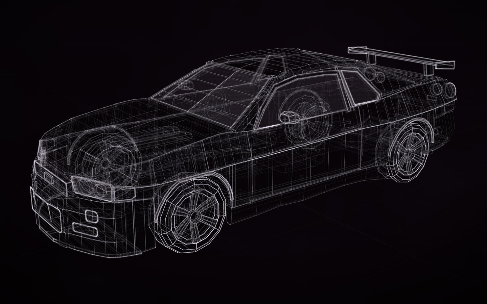

# Nissan Skyline GT-R R34

[](https://rtmandreyev.github.io/construct/examples/nissan-skyline-gt-r-r34/)

**masterpiece · Claude Opus 5.5**

[Open the live construct](https://rtmandreyev.github.io/construct/examples/nissan-skyline-gt-r-r34/): drag to orbit, R replays the assembly, L shows
labels. The scene it was built from: [scene.json](scene.json).

Build it yourself from a checkout of Construct:

```sh
python3 construct_hologram/cli.py build examples/nissan-skyline-gt-r-r34/scene.json --out out/nissan-skyline-gt-r-r34
```

## Refined for the solid (1.2)

The light forgives what a solid does not. Seen as a solid (**S** on the page) and exported to Blender, the first
version showed defects the checks had let through. This version answers them, and every part keeps its name:

- **C-pillar** (`sail-panel`): a fully rounded fin at 36° that stopped short of the rear glass, left a hollow
  between itself and the glass and ran forward through the quarter window. It now closes the pillar from the
  shoulder up under the rear glass and above the quarter window's slanted edge up under the roof.
- **Bumper flanks** (`front-bumper-side`, `-2`): plates 2 cm thick with nothing behind them, an open-sided
  bracket ahead of each front wheel. Each is a closed flank 6 cm deep behind the same outer face.
- **Rear bumper and tail panel**: rounded by 0.9 of their half height (21 cm), a pillow rolling away from the
  quarter panels; now rounded as a moulded bumper is.
- **Sills** (`side-skirt`): their lower edge wandered by 5 cm and their top stood out of the door by up to 3 cm,
  a notched seam; now straight, and flush with the panels above.
- **Diffuser**: square in plan under a bumper rounded in plan, its corners stood out; its strakes hung below it,
  touching nothing. It follows the bumper, and the strakes reach up into it.
- **Wing to cowl** (`fender-front-upper`): its rear end stood 2 cm below the bonnet. It meets it.
- **Tubes**: 37 suspension arms, shafts, pipes and springs were open at both ends; they are capped.

The C-pillar, the sills, the diffuser and its strakes are no longer the tracing, and say so (`inferred`, with a
note); nothing claims more than before. The light is all but unchanged.

### The glasshouse and the corners (1.2)

A second pass, judged in the solid and in Blender, on what still did not fit:

- **Windows in their frames:** the A-pillars (`a-pillar`, `a-pillar-upper`) were flat-topped bars 10 cm wide and
  8.5 cm deep, standing up to 9 cm above the door frame; each is now a strip 2 cm deep laid between the windscreen's
  edge and the door frame, 4-6 mm proud of the glass. The sashes stand 4 mm proud of their glass (they stood
  1.4 cm); the B-pillar fills between the two sashes, flush, where it was a 5 mm strip between two bars; the door and
  quarter glass run into the belt instead of stopping 1-2 cm above it; the C-pillars run over the rear glass's edge.
  Every pane now meets its frame or panel along at least 95% of its edge (within 4 mm).
- **Rear corners:** the rear quarter panels (`quarter-upper`, `quarter-lower`) ran past the tail panel's rounded
  corner and ended in flat caps standing 2.6-4 cm out of it; they are turned onto it, and the upper one ends where
  the tail panel begins. The tail lamps are tilted 11° to the tail panel's face and set on it (they stood out at
  the top and sank in at the bottom).
- **Front bumper corners** (`front-bumper-side-2`): the flank ran 4.5 cm past the bumper's bands and ended in a
  square end; it ends where they begin.

These parts say how they are now known (`inferred` where they are no longer the tracing, with a note).
