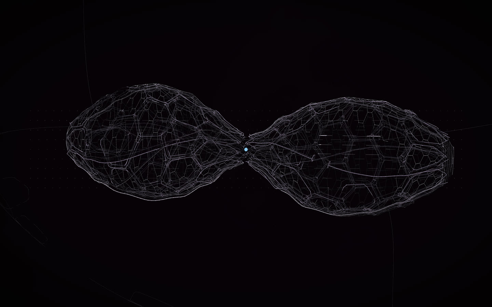

# Object 001

**masterpiece · Claude Opus 5.5, then GPT-6.1 Sol**

An alien object, five kilometres long in the film: two porous lobes grown like the inside of a bone, almost mirrored across a pinched waist, one half slightly out of true. Nothing like it exists; it is built from structures that do.

[Open the live construct](https://rtmandreyev.github.io/construct/examples/object-001/): drag to orbit, R replays the assembly, P shows every part as
designed (none is measured: it does not exist), S shows it as a solid.

Made for the author's visual album film. How to design something like it, with a brief of your own:
[New things from real ones](../../docs/for/invent-from-what-exists.md).

**Not published:** the scene and the brief it was made from. **Rights:** all rights reserved, to view only;
not under Construct's Apache-2.0 licence ([LICENSE](LICENSE)).
