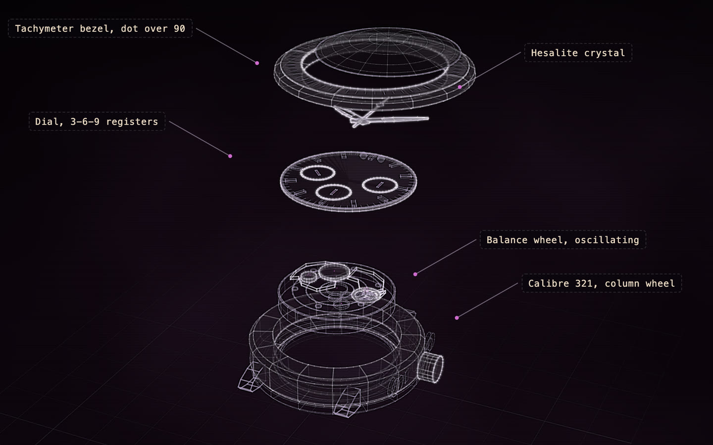

# Omega Speedmaster, calibre 321

[](https://rtmandreyev.github.io/construct/examples/omega-speedmaster-321/)

**fast · DeepSeek V4.1 Flash**

[Open the live construct](https://rtmandreyev.github.io/construct/examples/omega-speedmaster-321/): drag to orbit, R replays the assembly, L shows
labels. The scene it was built from: [scene.json](scene.json).

**Revised after the run.** The domed crystal's id did not say glass, and everything past the light (the solid view,
the 3D export, prints and kits) knows glass by its id, so the crystal came out as an opaque dome. It is now
`crystal-glass`: see-through in the solid view, with the dial under it. An independent critic judged the revised
scene; its answer is recorded in the scene.

Build it yourself from a checkout of Construct:

```sh
python3 construct_hologram/cli.py build examples/omega-speedmaster-321/scene.json --out out/omega-speedmaster-321
```
