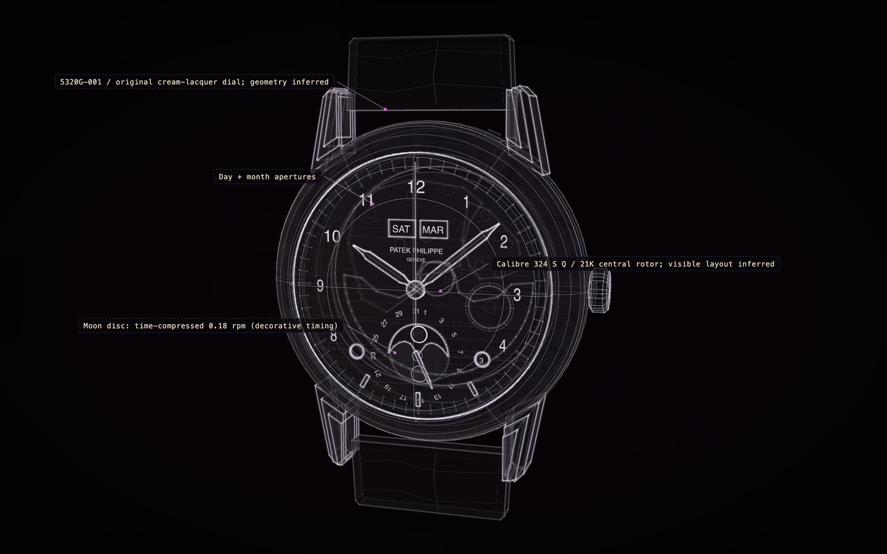

# Patek Philippe 5320G

[](https://rtmandreyev.github.io/construct/examples/patek-philippe-5320g/)

**fast · GPT-6.1 Sol**

[Open the live construct](https://rtmandreyev.github.io/construct/examples/patek-philippe-5320g/): drag to orbit, R replays the assembly, L shows
labels. The scene it was built from: [scene.json](scene.json).

**Revised after the run.** The box sapphire and the sapphire caseback had ids that did not say glass, and everything
past the light (the solid view, the 3D export, prints and kits) knows glass by its id, so the solid view showed a
blank grey dome over the dial. They are now `box-sapphire-glass` and `back-sapphire-glass`: the dial, its numerals
and the calendar windows show through the crystal, and the movement through the back. In the light the two sapphires
are now drawn as outlines: their faint fill sat a few millimetres above the dial and hid its printed numerals,
signature and date ring. An independent critic judged the revised scene; its answer is recorded in the scene.

Build it yourself from a checkout of Construct:

```sh
python3 construct_hologram/cli.py build examples/patek-philippe-5320g/scene.json --out out/patek-philippe-5320g
```
