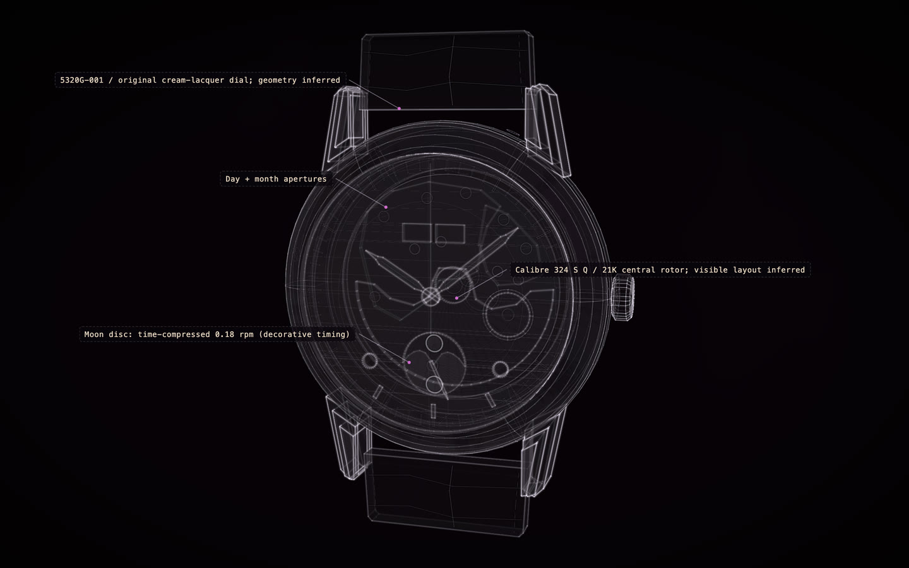

# Patek Philippe 5320G

[](https://rtmandreyev.github.io/construct/examples/patek-philippe-5320g/)

**fast · GPT-6.1 Sol**

[Open the live construct](https://rtmandreyev.github.io/construct/examples/patek-philippe-5320g/): drag to orbit, R replays the assembly, L shows
labels. The scene it was built from: [scene.json](scene.json).

Build it yourself from a checkout of Construct:

```sh
python3 construct_hologram/cli.py build examples/patek-philippe-5320g/scene.json --out out/patek-philippe-5320g
```
