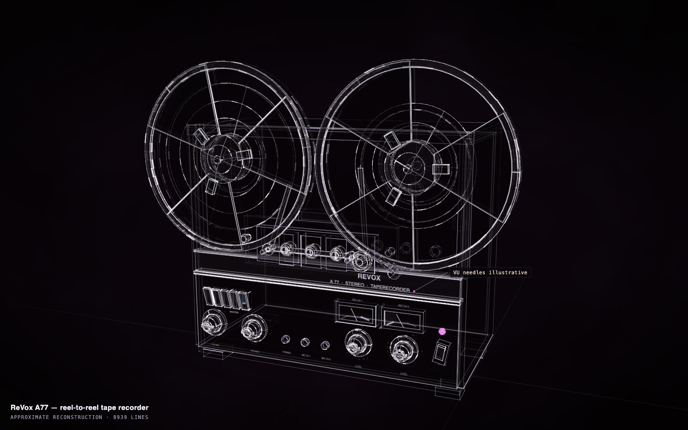

# Revox A77

[](https://rtmandreyev.github.io/construct/examples/revox-a77/)

**Made by** DeepSeek · showcase (30 minutes) · with a Construct 0.2.1 development build.

[Open the live construct](https://rtmandreyev.github.io/construct/examples/revox-a77/) (drag to orbit, R replays the assembly, L shows labels) ·
[scene.json](scene.json)

**Reproduces with Construct 0.2.1.** `check` passes (0 warnings),
and the 0.2.1 compiler renders this hero pixel for pixel as the build that made it did.

```sh
python3 construct_hologram/cli.py build examples/revox-a77/scene.json --out out/revox-a77
```
