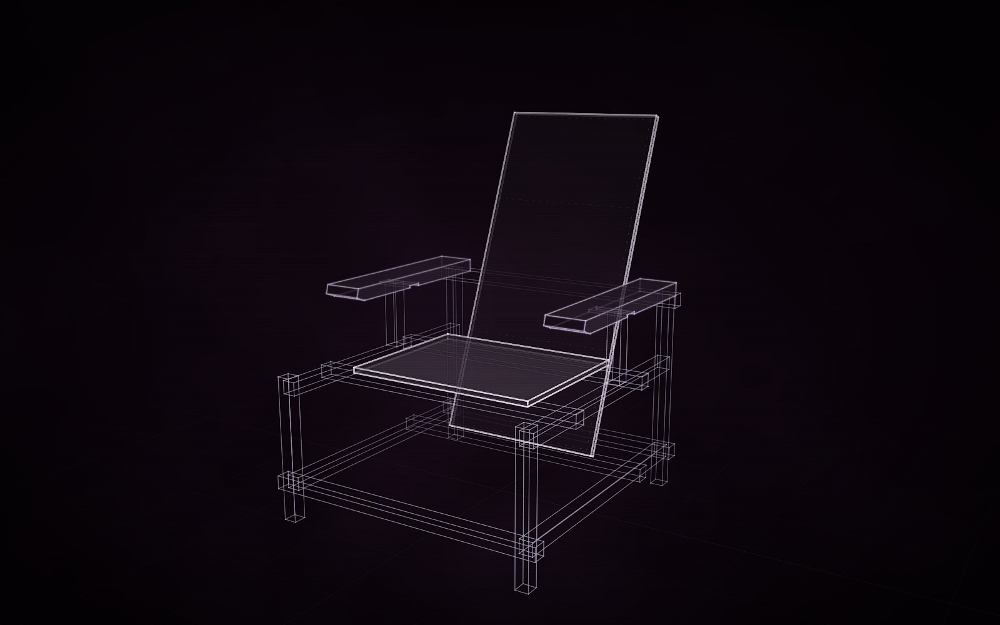

# Rietveld Red-Blue Chair



**masterpiece · DeepSeek V4.1 Flash**

Gerrit Rietveld's Red-Blue Chair (designed 1918, painted about 1923): thirty-millimetre beech battens carrying the
plywood seat and back and two board arms, sized to the example in the Museum of Modern Art (867 × 660 × 838 mm,
seat 330 mm high), with the member layout and the back board's lean from a dimensioned drawing. Built by DeepSeek
V4.1 Flash through Hermes in masterpiece rounds, each judged by an independent critic (last verdict: good).

Build it yourself from a checkout of Construct:

```sh
python3 construct_hologram/cli.py build examples/rietveld-red-blue-chair/scene.json --out out/rietveld-red-blue-chair
```
