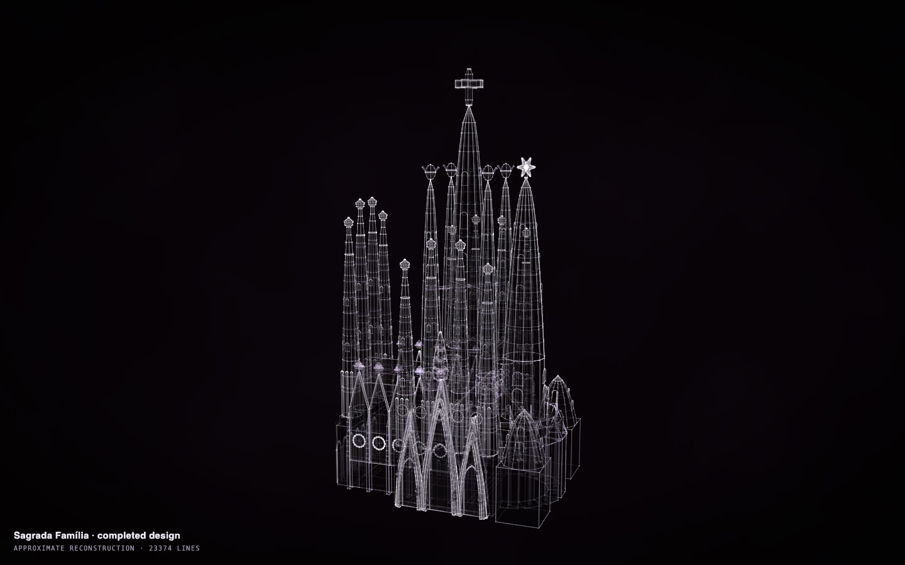

# Sagrada Família

[](https://rtmandreyev.github.io/construct/examples/sagrada-familia/)

**Made by** GPT-6.1 Sol · masterpiece · with a Construct 0.2.1 development build.

[Open the live construct](https://rtmandreyev.github.io/construct/examples/sagrada-familia/) (drag to orbit, R replays the assembly, L shows labels) ·
[scene.json](scene.json)

**Reproduces with Construct 0.2.1.** `check` passes (2 warnings: tiny),
and the 0.2.1 compiler renders this hero pixel for pixel as the build that made it did.

```sh
python3 construct_hologram/cli.py build examples/sagrada-familia/scene.json --out out/sagrada-familia
```
