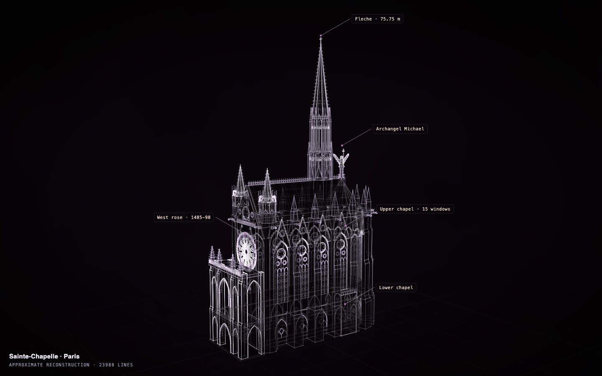

# Sainte-Chapelle

[](https://rtmandreyev.github.io/construct/examples/sainte-chapelle/)

**Made by** Claude Opus · masterpiece rounds, round 15 · with Construct 0.2.1 (the released rounds loop).

[Open the live construct](https://rtmandreyev.github.io/construct/examples/sainte-chapelle/) (drag to orbit, R replays the assembly, L shows labels) ·
[scene.json](scene.json)

**Reproduces with Construct 0.2.1.** `check` passes (22 warnings: clutter, tier-rounds, tiny),
and the 0.2.1 compiler renders this hero pixel for pixel as the build that made it did. Its round history (`authoring.rounds`) was completed with round 15, the round this scene comes from, from the run's own log; nothing else in the scene changed.

```sh
python3 construct_hologram/cli.py build examples/sainte-chapelle/scene.json --out out/sainte-chapelle
```
