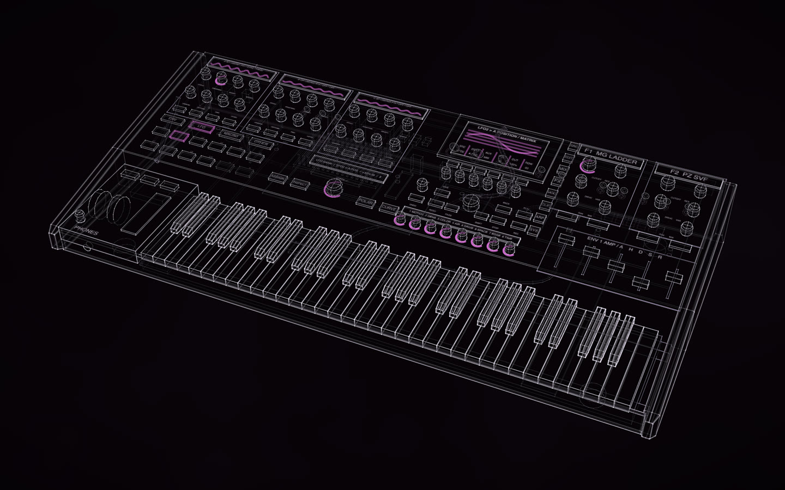

# SERUM 2 / 61, an unaffiliated concept from a manual

> **Unaffiliated concept. Not endorsed by Xfer Records.** Serum 2 is Xfer Records' software synthesizer. This
> instrument is an invented concept made from its public manual; Xfer Records and its people had no part in it and
> have not seen or approved it.

[](https://rtmandreyev.github.io/construct/examples/serum-2-61/)

**masterpiece · GPT-6.1 Sol, in Codex**

[Open the live construct](https://rtmandreyev.github.io/construct/examples/serum-2-61/): drag to orbit, R replays the
assembly (the electronics are built before the panel and keys, and the service deck then opens on its stay), P
shows how each part is known, S shows it as a solid. The scene: [scene.json](scene.json). The whole story, from the brief to what it does
not show: [Documentation → product](../../docs/for/documentation-to-product.md).

A standalone 61-key instrument designed around the documented Serum 2 engine, from the manual alone: three
oscillator strips, two filters, a central graph display with six encoders, twelve source pads, an ASSIGN, INSPECT
and signed DEPTH section for modulation, eight macros, envelope faders, rear I/O and an electronics bay under a
hinged control deck. Every physical part is designed; none is measured, and none is Xfer's.

## This is the audited revision

The construct was made in one autonomous run. An independent audit then read the run and found a few things worth
correcting; this folder is that correction, **not a redesign**: the same instrument, the same parts in the same
places, labelled as a revision in its own caption and provenance note. The original autonomous result is the one
shown in images on the walkthrough page; the run's own documents are in [run/](run/), unchanged except for a removed
local path, and its brief is [PROMPT.md](PROMPT.md).

| What changed | Why |
| --- | --- |
| Requirement-linked provenance: the 44 requirement groups (`serum.R01`–`serum.R44`, cited to the manual's pages) and the brief's two premises (61 keys; a standalone instrument) are facts marked `"requirement": true`, and each designed part names the requirements it realises in its `basis` (the WARP knobs `serum.R04`, the ASSIGN section `serum.R22` and `serum.R25`, the compute and audio boards the standalone premise) | In the original no part cited the requirement it answers, so the trace from requirement to control lived only in the function map; `check` now says *222 designed parts to a requirement, 35 designed freely*, and **P** splits DESIGNED the same way |
| The design's own statements (`product.design`, `key.pitch`, the overall sizes) taken out of the parts' bases | They are the design describing itself, not evidence, and they made every part read as DESCRIBED; designed parts now read as designed |
| `subject.accuracy: "original"` | The caption read APPROXIMATE RECONSTRUCTION; it now reads ORIGINAL DESIGN |
| R35, the harmonic editor: a bin count removed | It is not on the pages that row cites (pp. 278–280), yet the row was marked verified |
| R36: "sidecar" text overrides renamed per-file `.txt` and `FolderInfo.txt` overrides | The manual's own terms |
| FILES and SHIFT keys added beside the BROWSE encoder (hold SHIFT and touch a control for its help), with their legends | The function map sends import, storage and database work to FILES, harmonic ranges to Shift and help to a hold, but the original panel had none of them. The six soft keys under the display are the map's "tool keys", and its "BROWSE encoder" and "navigator" are one control |
| Black keys stand 12 mm above the white keys, not 19 mm | About 12 mm is usual on a full-size keybed |
| Knob tops closed; controls set on their printed overlays, not through them; the rear connectors' backs flush with the panel; the converters on their board; the key scanner under the keybed frame; the keybed frame ending at the front apron; the panel board clear of the service stay; harnesses leaving their boards from the top | `check --fit` (Construct 1.2) found open shells, pokes and buried parts in the original; these were real geometry slips, fixed rather than suppressed |
| The reading notes name keys 1–6, L and R, not an O key and keys 7–8 | The viewer has no O key and six view keys |
| The identity checklist's "three oscillator strips" sourced to design, not the manual | The manual documents three oscillators; strips are a design choice |
| The critic record removed, the outcome `self-reviewed` | The critic judged the original scene, not this revision. The run's five rounds stay in `authoring.rounds` |

The scene's `revision` fact and its provenance note say the same in brief.

## Checks

```text
construct check scene.json --fit
audit: PASS (0 errors, 3 warnings)
  warn [tiny] electronics-standoffs, eight-channel-dac, stereo-adc: under 1.5% of the object's size
  evidence-backed key parts: 0 of 215
  designed parts: 222 to a requirement (request.keys, request.standalone, serum.R01, ...), 35 designed freely
fit: 4 buried (the DAC, the ADC and the line drivers on their 4 mm board, the fan hubs in their frames)
```

No `requirement-unmet`: every requirement is realised by at least one part. The four buried parts are thinner than
the default fit voxel (6.75 mm here); at `--cells 480` and `--cells 600` the fit reports *nothing pokes through or
hides*. The three tiny parts are real chips at real size. The original scene, checked with the same toolkit, had 12
pokes, 19 buried parts and 54 open shells. These are checks of a representation, not engineering validation.

## How the original was made

| | |
| --- | --- |
| Agent | Codex, on the desktop, one task (64 min 27 s from start to finish); the brief written in advance |
| Model | GPT-6.1 Sol, high reasoning effort; the critics were fresh agents of the same model |
| Construct | 1.1.0, installed as a skill; its 256-part cap limited the bay's detail |
| Mode | masterpiece: five critic rounds, the loop reaching its configured stop condition |
| Specification | the Serum 2 User Guide, 354 pages, Serum 2.0.18, manual 1.0.3 (27 April 2025), downloaded by the agent |
| Frame | metres, +Y up, the player towards +Z, the origin on the floor under the instrument's centre |

The revision was made with Construct 1.2 by Claude Opus 5.5, from the frozen scene, by script; nothing was
re-generated.

## Build it

From a checkout of Construct:

```sh
python3 construct_hologram/cli.py build examples/serum-2-61/scene.json --out out/serum
python3 construct_hologram/cli.py export examples/serum-2-61/scene.json --out serum.glb \
    --materials examples/serum-2-61/materials.json   # named parts, the deck's hinge, a finish for Blender
```

[materials.json](materials.json) is the run's own finish proposal (dark anodized aluminium, polymer keys, cover
glass, elastomer wheels), with one rule moved first so the key scanner is not finished as a key.

Apache-2.0, like the rest of Construct. Serum and Xfer Records are trademarks of their owner, named here only to
say what the concept was made from. Nothing on this page claims a working instrument: no firmware, DSP parity,
realtime capacity, electrical, thermal or ergonomic performance is shown.
