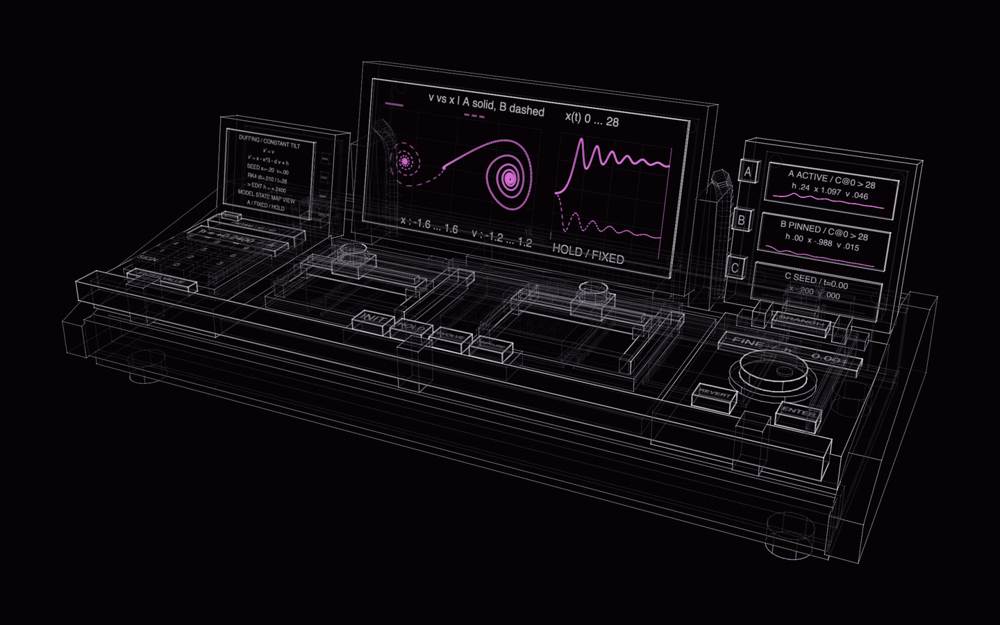

# State Bench, an invented instrument

[](https://rtmandreyev.github.io/construct/examples/state-bench/)

**masterpiece · GPT-6.1 Sol**

[Open the live construct](https://rtmandreyev.github.io/construct/examples/state-bench/): drag to orbit, R replays the
assembly (the service drawer then slides out and its connector face folds down), P shows how each part is known, S
shows it as a solid; its views include the control surface, the cross slides, the state archive and the drawer open.
The scene: [scene.json](scene.json).

An original scientific instrument that does not exist: a bench for repeatable numerical experiments on dynamical
systems, at the scale of an object where [KESTREL](../kestrel/) is a ship. It was asked for as a purpose, not a
shape, and the shape follows the purpose. Two clutch-gripped orthogonal cross slides move four parameters with two
hands; a raised central display plots one run's phase plane beside its time history; a right-hand archive keeps the
active run, a pinned baseline and the common starting state in three separate windows, with a recessed BRANCH key
so recalling a state never overwrites it; a keypad and an encoder turn a promising neighbourhood into exact numbers.
Underneath, a service drawer slides out on telescoping runners: compute, power, storage and cooling modules on
keyed carriers, their leads ending at power and data spines, and a connector face that folds down once the drawer
is out. 263 parts, about 1.71 × 0.78 × 0.65 m.

The plots are computed, not drawn. The screens compare two runs of a damped, tilted Duffing oscillator
(ẍ = −δẋ + x − x³ + h, δ = 0.25) from the same state, x = −0.20, v = 0: run A with h = 0.24 settles into the
right-hand well and run B with h = 0 into the left. Both are RK4 solutions to t = 28 with a step of 0.01, checked
against an independent finer integration; the archive thumbnails repeat the same records. The run claims no more
than that: two trajectories approaching different equilibria, not chaos, a bifurcation or global stability.

Every part is designed, marked inferred, and tied in `basis` to the requirement it serves (the brief, or the
instrument's operating specification); none claims a verified shape. Real instruments supplied operating
principles only: analog computers' separate initial, operate and hold modes, the oscilloscope's XY plot, manual
translation stages, crew-interface guidance on detents and stops, and incremental encoders. No geometry, panel or
artwork was copied from them, and there is no logo or decoration. It is a concept model, not CAD: bearing sections,
electrical detail, thermal sizing and ergonomics would need a prototype.

## How it was made

| | |
| --- | --- |
| Model | GPT-6.1 Sol |
| Construct | 1.2, as a local tool |
| Mode | masterpiece, every critic a fresh, isolated subagent |
| Rounds | 7, 33 active minutes and 28 critic minutes; the best round 7, stopped with every criterion at 3 |

The brief, in short: a plausible near-future dedicated scientific instrument for loading complex dynamical models,
setting states and assumptions, manipulating parameters, evolving, holding and resetting, branching from saved
states, comparing outcomes and inspecting state-space trajectories and their stability. Research real precedents
and the operating purpose before any geometry. A substantial horizontal bench with distinct functional zones,
tactile and precise controls, coordinated scientific displays, a complete modular interior and real service access;
serious and restrained, in the lineage of analog and hybrid computers, laboratory measurement and modern numerical
simulation. No synthesizer look, keyboard, rows of knobs for their own sake, retro styling, generic sci-fi
decoration, random waveforms or logos. The critics were asked whether every prominent component can be explained by
what it does, whether it stays a coherent instrument without its labels, and whether it is interesting because of
what it is.

The critics' first asks were about meaning, not looks: the model and the starting state were not on the instrument
(round 1), the archive did not show what a branch preserves (round 1), the branch guard stood in front of the
starting-state window (round 3), A and B were one colour with no key (round 4), and the drawer's modules read as
boxes with no way in or out (rounds 5 to 7). Each was fixed in the scene and judged again.

## Build it

From a checkout of Construct:

```sh
python3 construct_hologram/cli.py build examples/state-bench/scene.json --out out/state-bench
python3 construct_hologram/cli.py export examples/state-bench/scene.json --out state-bench.glb   # 263 named parts, the drawer's joints
```

Apache-2.0, like the rest of Construct.
