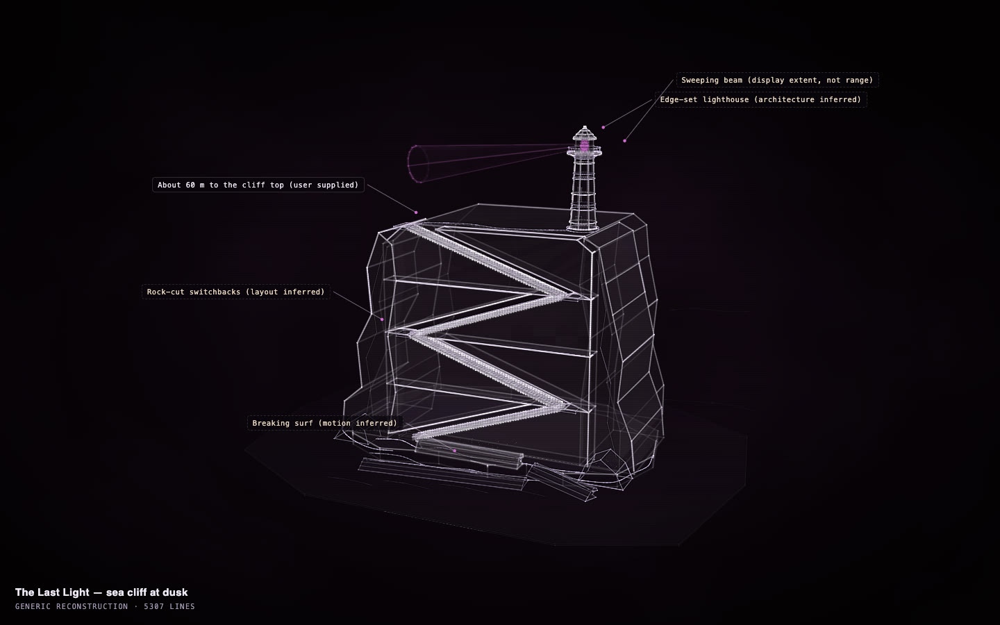

# The Last Light: sea cliff at dusk

[](https://rtmandreyev.github.io/construct/examples/the-last-light/)

**Made by** GPT-6.1 Sol · a single first pass · with a Construct 0.2.0 development build.

[Open the live construct](https://rtmandreyev.github.io/construct/examples/the-last-light/) (drag to orbit, R replays the assembly, L shows labels) ·
[scene.json](scene.json)

**Reproduces with Construct 0.2.1.** `check` passes (8 warnings: thin),
and the 0.2.1 compiler renders this hero pixel for pixel as the build that made it did.

```sh
python3 construct_hologram/cli.py build examples/the-last-light/scene.json --out out/the-last-light
```
