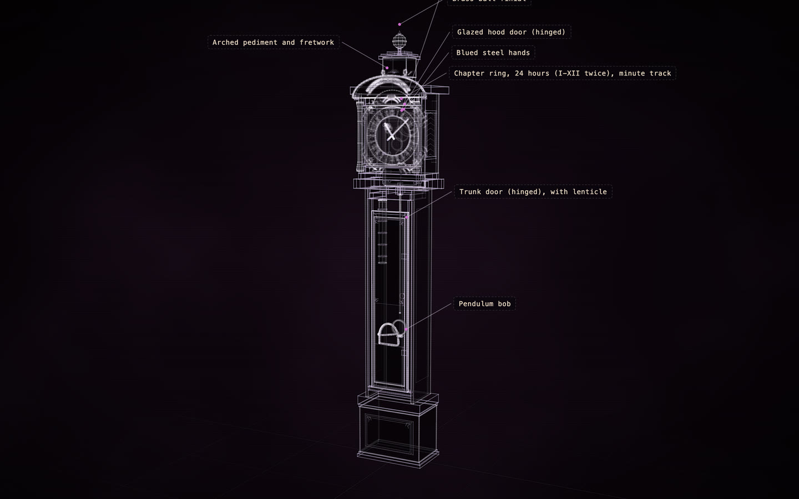

# Tompion year-going longcase clock

[](https://rtmandreyev.github.io/construct/examples/tompion-year-going-clock/)

**masterpiece · DeepSeek V4.1 Flash**

[Open the live construct](https://rtmandreyev.github.io/construct/examples/tompion-year-going-clock/): drag to orbit, R replays the assembly, L shows
labels, P shows how each part is known, S shows it as a solid. The scene it was built from: [scene.json](scene.json).

Thomas Tompion's year-going clock for William III (about 1695), in the Royal Collection (RCIN 57800), built by
DeepSeek V4.1 Flash through Hermes in twelve masterpiece rounds, each judged by an independent critic. Every
step after it, from the provenance view to a model kit, is in [a longcase clock, end to end](../../docs/END-TO-END.md),
with the finish ([maps/finish.json](maps/finish.json)) and the kit plan ([kit-plan.json](kit-plan.json)) it used.

Build it yourself from a checkout of Construct:

```sh
python3 construct_hologram/cli.py build examples/tompion-year-going-clock/scene.json --out out/tompion-year-going-clock
```
