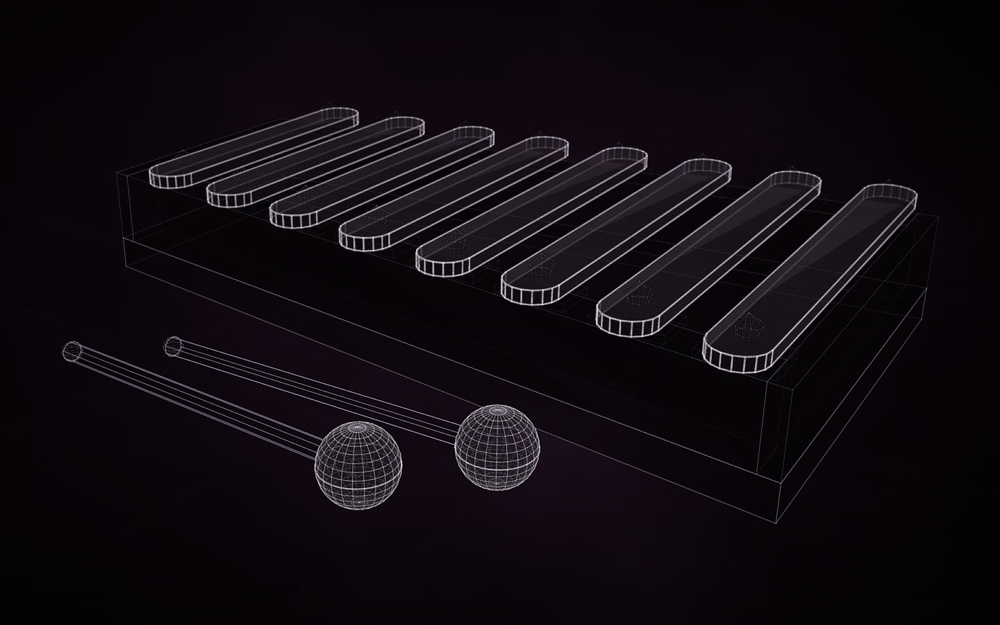
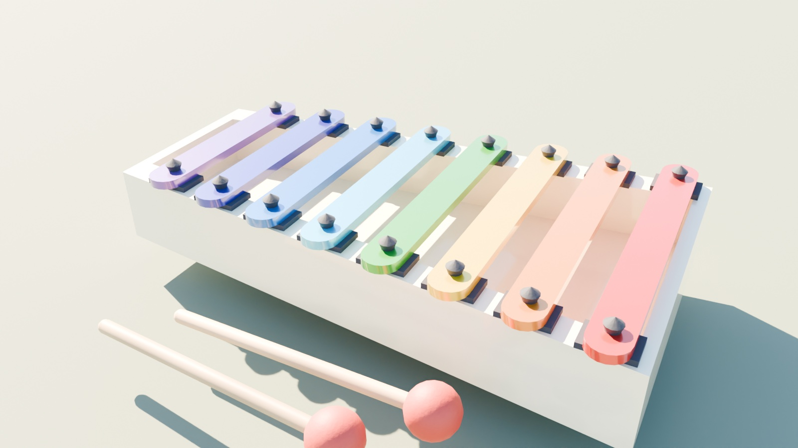

# A child's toy xylophone

[](https://rtmandreyev.github.io/construct/examples/toy-xylophone/)

**fast · DeepSeek V4.1 Flash**, made in Hermes in about nine minutes, self-reviewed.

[Open the live construct](https://rtmandreyev.github.io/construct/examples/toy-xylophone/): drag to orbit, P shows how each part is known, S shows it as a
solid. The scene: [scene.json](scene.json); its finish: [scene.materials.json](scene.materials.json).

Eight lacquered metal bars in rainbow order, 240 mm down to 170 mm in 10 mm steps (a taper of 0.708, the octave
ratio for a free bar, so longest to shortest is also a scale), each on two felt pads and held by two rubber pegs, on a
painted wooden frame; two beech mallets with red rubber heads in front. Every size is inferred from a
typical toy of this kind, and the scene says so: a generic reconstruction, nothing measured.

## Finished by default

This example was made to test one thing new in 1.3: every construct finishes itself with a material map. The
request describes the toy, its colours and materials among the rest, but never mentions a map or a finished export:

> Make a construct of a child's wooden toy xylophone: eight metal bars in rainbow colours (red, orange, yellow,
> green, light blue, blue, indigo, violet), longest to shortest, resting on felt pads on a painted wooden trapezoid
> frame, each bar held by two small rubber pegs, and two beech mallets with round red rubber heads lying in front.
> Keep it simple and do it well. When it is done, export it as a glTF for Blender.

As the skill's last building step, DeepSeek wrote [`scene.materials.json`](scene.materials.json) beside the scene:
each bar its colour as lacquered paint, the frame cream enamel, the pads grey felt, the pegs black rubber, the
mallets beech with red rubber heads. Its `about` line says the exact colours are its own choices, not a documented
product's. The glTF it exported used the map without being told, and imported into Blender with Construct's add-on it
comes out finished, with no work in Blender:

<p align="center"></p>

```sh
construct export examples/toy-xylophone/scene.json --out xylophone.glb    # finished from scene.materials.json
construct export examples/toy-xylophone/scene.json --out xylophone.glb --materials my-colours.json   # another finish
```

The map is a small text file: change a colour there, or ask the agent to, and every export after follows.
