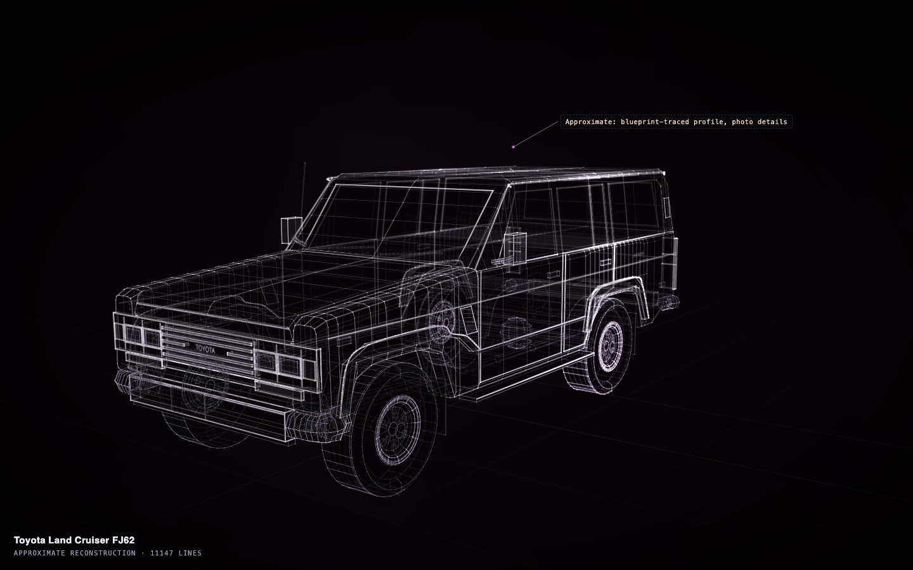

# Toyota Land Cruiser FJ62

[](https://rtmandreyev.github.io/construct/examples/toyota-land-cruiser-fj62/)

**Made by** Claude Opus · masterpiece rounds, round 11 · with a Construct 0.2.1 release-candidate build (the c2p rounds variant).

[Open the live construct](https://rtmandreyev.github.io/construct/examples/toyota-land-cruiser-fj62/) (drag to orbit, R replays the assembly, L shows labels) ·
[scene.json](scene.json)

**Reproduces with Construct 0.2.1.** `check` passes (10 warnings: tiny),
and the 0.2.1 compiler renders this hero pixel for pixel as the build that made it did.

```sh
python3 construct_hologram/cli.py build examples/toyota-land-cruiser-fj62/scene.json --out out/toyota-land-cruiser-fj62
```
