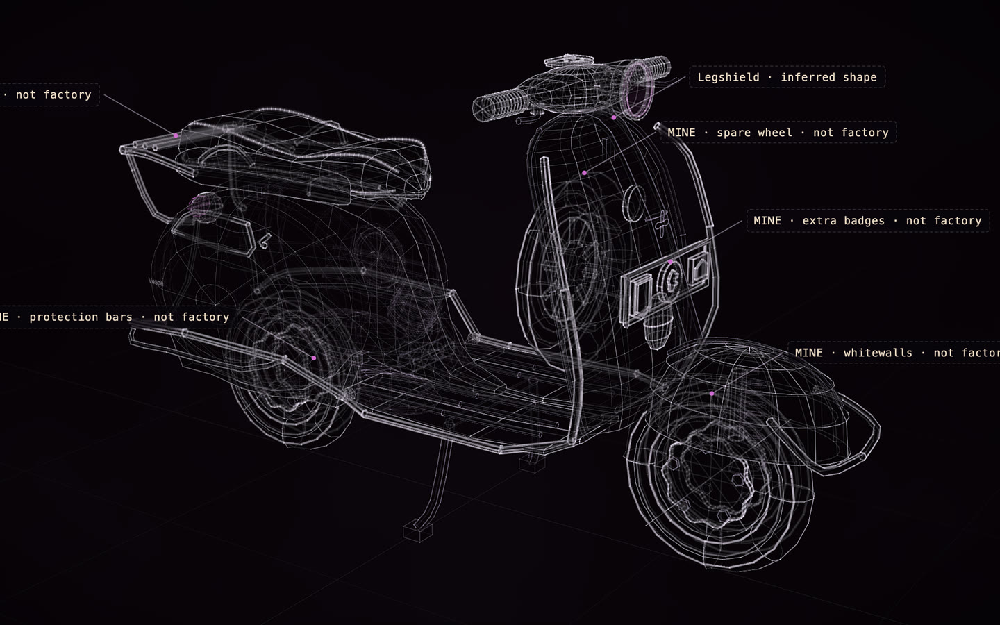

# Vespa GS 150, an owner's scooter

[](https://rtmandreyev.github.io/construct/examples/vespa-gs150/)

**masterpiece · GPT-6.1 Sol**

[Open the live construct](https://rtmandreyev.github.io/construct/examples/vespa-gs150/): drag to orbit, R replays the assembly, L shows labels, P shows how each part is
known, S shows it as a solid. The scene it was built from: [scene.json](scene.json); its finish for Blender and
the kit: [maps/finish.json](maps/finish.json); its kit plan: [kit-plan.json](kit-plan.json).

A 1960 Piaggio Vespa GS 150 from two photographs of one scooter and its published specifications, in twelve
masterpiece rounds through Hermes (GPT-6.1 Sol, high reasoning), each judged by an independent critic; the run
stopped at the 12-round cap with round 12 the best. The scooter in the photos is not stock, and the construct says
so: its whitewall tyres, chrome bars, rear rack, spare wheel and legshield badges are separate parts labelled as
the owner's, not the factory's, so a restorer can tell the two apart. The side cowls lift off, the handlebar
steers and the stand folds. [Your vehicle →](../../docs/for/your-vehicle.md) ·
[A kit of your own →](../../docs/for/a-kit-of-your-own.md)

The photographs, from Wikimedia Commons, stood in for an owner's own (they are not in this repository):
[front left](https://commons.wikimedia.org/wiki/File:Vespa_GS_3_150ccm_8PS_1960_1.jpg) and
[rear right](https://commons.wikimedia.org/wiki/File:Piaggio_Vespa_150_GS_1960b.JPG), both public domain.

Build it yourself from a checkout of Construct:

```sh
python3 construct_hologram/cli.py build examples/vespa-gs150/scene.json --out out/vespa-gs150
python3 construct_hologram/cli.py export examples/vespa-gs150/scene.json --out vespa.glb --materials examples/vespa-gs150/maps/finish.json
```
