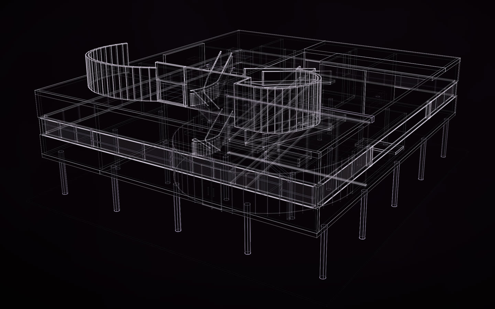
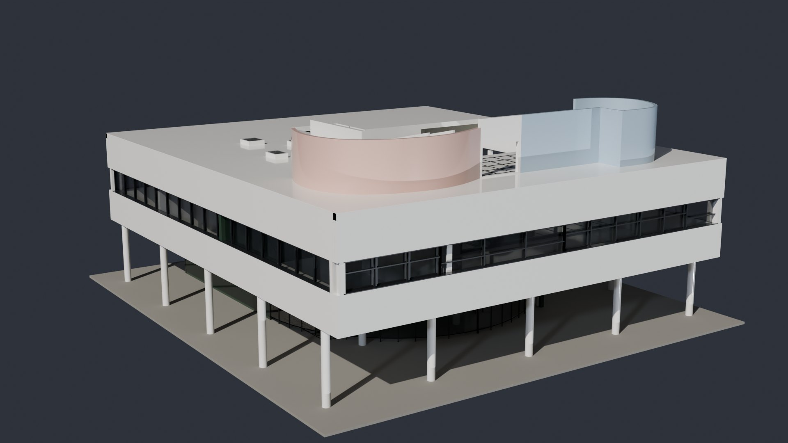
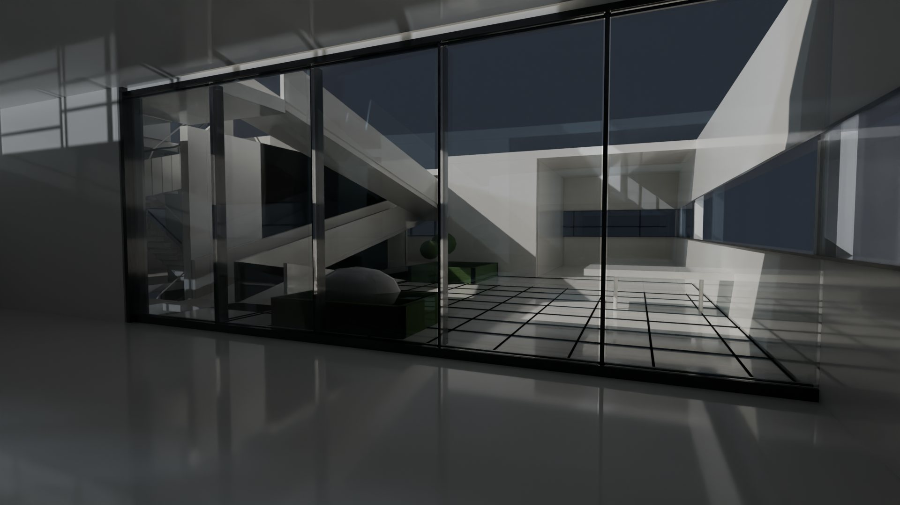
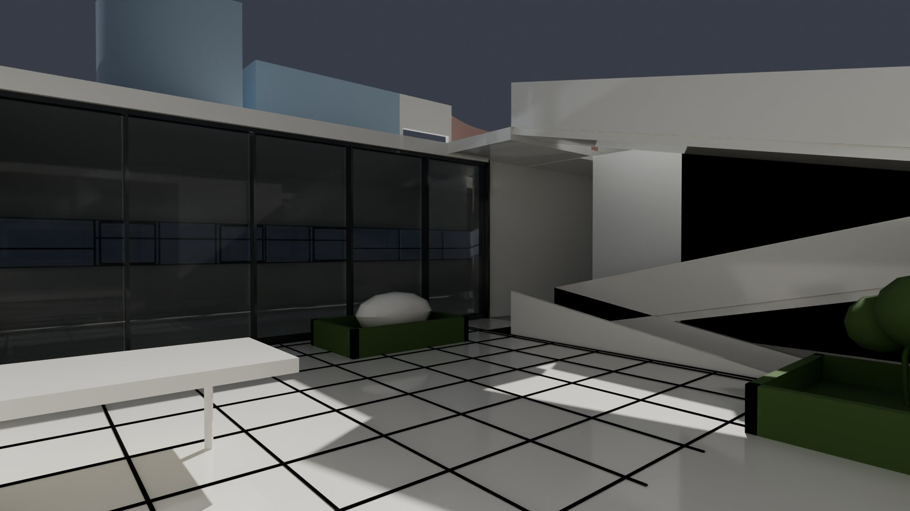
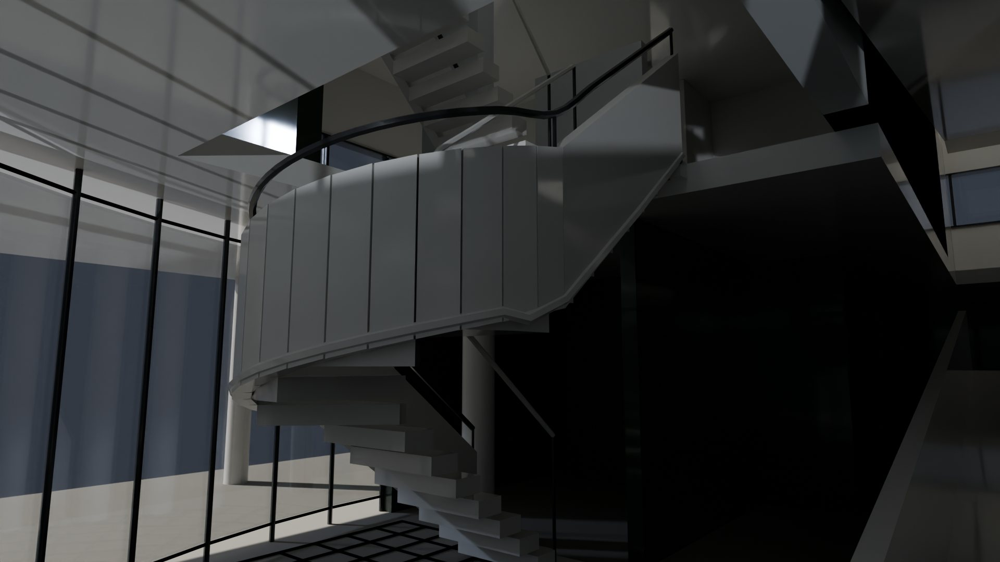
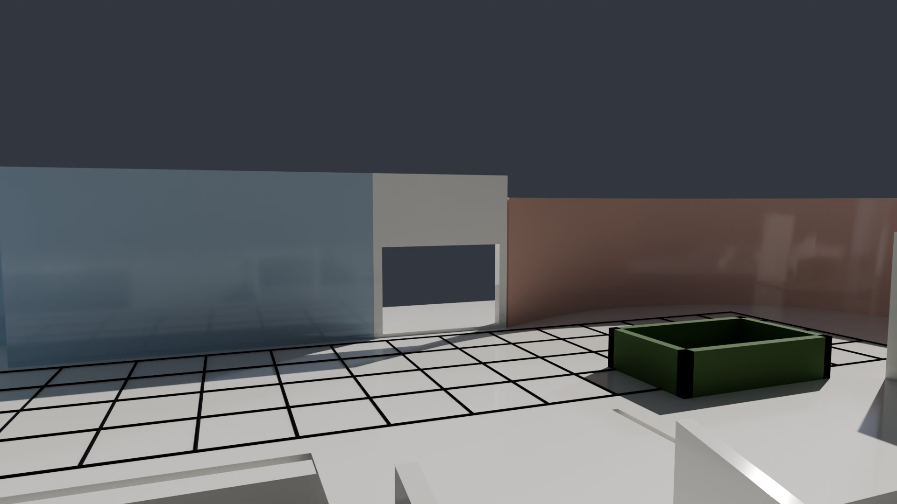
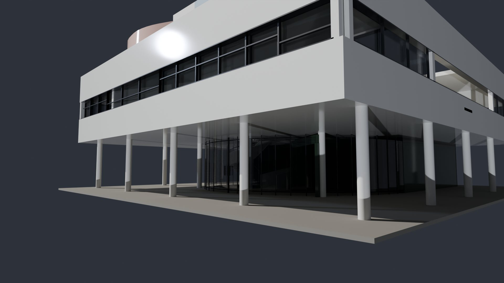
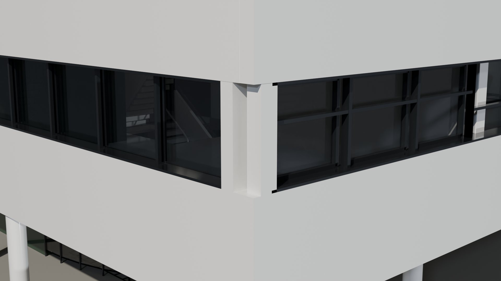
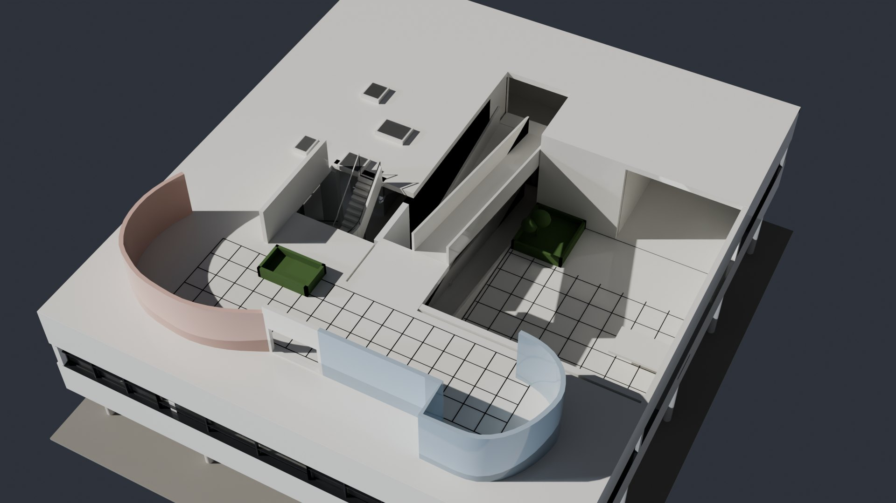

# Villa Savoye, made in Hermes

[](https://rtmandreyev.github.io/construct/examples/villa-savoye/)

**masterpiece · GPT-6.1 Sol, in Hermes Desktop with the Construct plugin**

[Open the live construct](https://rtmandreyev.github.io/construct/examples/villa-savoye/): drag to orbit, R replays the assembly
(the pilotis first, then the floors, the ramp, the ribbon windows and the roof garden), P shows how each part is
known, S shows it as a solid. The scene it was built from: [scene.json](scene.json); its finish for Blender:
[maps/finish.json](maps/finish.json); its desktop model kit: [the 3D guide](https://rtmandreyev.github.io/construct/examples/villa-savoye/kit/assembly.html).

Le Corbusier and Pierre Jeanneret's house at Poissy (1928–1931), reconstructed from its published plans, section and
dimensions: the pilotis lifting the main floor, the ribbon windows, the ramp through the middle of the house in four
flights, the roof garden with its two unequal curved solarium screens, and the ground floor's curved glass wall
drawn round a car's turning circle. 396 named parts. It is an approximate reconstruction: the plan outlines are
traced, the overall sizes are published ones, and nearly everything else (storey heights, thicknesses, glazing,
treads, furniture) is inferred, and **P** shows it so.

This is the construct of the final test of Construct 1.2: five plain requests in Hermes, from the request to the
research, twelve masterpiece rounds, a question about what is known, a solid fit repair, glTF, STEP and FreeCAD
exports, a 30-piece desktop kit and a film. The whole run, step by step:
[Villa Savoye in Hermes, step by step →](../../docs/for/hermes-walkthrough.md)

<p align="center"></p>
<p align="center"><sub>The same scene finished in Blender with Construct's add-on and the material map in <code>maps/</code>; more stills, inside
and out, <a href="#in-blender">below</a>.</sub></p>

## In Blender

The same scene, finished with Construct's Blender add-on and the material map in [maps/finish.json](maps/finish.json), and
rendered in Cycles. Every surface below is a named part of the construct: the salon's glazing, the stair's winders
and rails, the solarium's framed opening, the sashes in their reveals.

<p align="center">
  
  
</p>
<p align="center">
  
  
</p>
<p align="center">
  
  
</p>
<p align="center"></p>
<p align="center"><sub>Inside the salon, looking out to the terrace and the ramp · on the terrace · the stair from the entrance hall · the roof garden's framed opening · under the pilotis · a corner of the ribbon window · from above.</sub></p>

## How it was made

| | |
| --- | --- |
| Agent | Hermes Agent 0.22.7, in Hermes Desktop, with the Construct plugin (1.2.0 before its release) |
| Model | GPT-6.1 Sol, reasoning effort high (author and every critic; each critic a separate Hermes subagent given only the sealed round packet) |
| Mode | masterpiece, 12 rounds, every round kept over the one before; stopped at the 12-round cap with the critic's verdict *good* (not outstanding) |
| Time | the build 2 h 25 min (22:54 to 01:19): 59.8 active authoring minutes and 76.2 critic minutes. Then a question, the fit repair, the exports, the kit and the film in about an hour more |
| Frame | metres, +Y up, the origin at the centre of the presentation ground (21 × 23 m); the house's footprint is the published 19 × 21.5 m |

The requests, in order, as typed. The first three were one conversation; the exports, kit and film a second, after
the plugin was restarted with fixes, which found the project by its name:

1. *Make me a masterpiece construct of Le Corbusier's Villa Savoye in Poissy (1931). Research its published plans
   and dimensions first, and get the things that make it what it is right: the pilotis lifting the main floor, the
   long ribbon windows, the ramp through the middle of the house, the roof garden with its curved solarium walls,
   and the ground floor's curved glass wall shaped by a car's turning circle. Masterpiece mode.*
2. *What do we actually know about this house, and what did you have to design? Show me.*
3. *Check it as a solid, and fix whatever doesn't fit.*
4. *Export it for Blender and for CAD, and show me the 3D model here.*
5. *Now make Villa Savoye a model kit I can print on a desktop printer, and a short film of it assembling.*

## The sources

The scene cites them by URL and includes none of their images:

- the ground, first-floor and roof plans (© Fondation Le Corbusier), the section and photographs of the restored
  house, as reproduced by [ArchEyes](https://archeyes.com/the-villa-savoye-le-corbusier/);
- the official [World Heritage description](https://lecorbusier-worldheritage.org/villa-savoye-et-loge-du-jardinier)
  (the recessed ground floor, the pilotis, the car's turning arc, the promenade and the solarium);
- the published overall dimensions, 21.50 × 19.00 × 9.40 m, on
  [French Wikipedia](https://fr.wikipedia.org/wiki/Villa_Savoye#Plan_de_la_villa) (a secondary source, not a survey);
- the 4.75 m structural module, from Riccardo Bianchini's
  [study for Inexhibit](https://inexhibit.com/case-studies/le-corbusier-villa-savoye-part-2-architecture).

## The record

Written by the run itself, kept as it wrote them (paths to reference images it saved locally are named, not
included):

- [run/RESEARCH.md](run/RESEARCH.md): the sources, how the plans were aligned and scaled, what was revised (four
  ramp flights, not three; the roof level), and what stays inferred.
- [run/rounds.md](run/rounds.md): every masterpiece round, its scores, what changed and what the critic asked.
- [run/FINAL_VERIFICATION.md](run/FINAL_VERIFICATION.md): the record of round 12, before the fit repair.
- [run/SOLID_FIT_REPAIR.md](run/SOLID_FIT_REPAIR.md): the solid fit repair: 23 findings at 200 cells down to 4,
  2 at 600 (two joined guardrail assemblies, disclosed rather than hidden), and 63 coordinate checks.
- [run/KIT.md](run/KIT.md): the kit's own README, written for whoever prints it: printer assumption, slicing,
  assembly and its limits.

The kit is built from [kit-scene.json](kit-scene.json), a print copy the run made (a reinforced base, thicker treads
and parapets, planters seated on their plates), and [kit-plan.json](kit-plan.json), its grouping and order:

```sh
construct kit kit-scene.json --plan kit-plan.json --scale 115 --printer desktop --materials maps/finish.json --out kit/
```

It has not been printed or assembled by anyone. The material map for Blender (white render, dark steel frames, the
ground floor in dark green, the solarium screens in rose and pale blue) was written for this page, not by the run;
for the stills on this page, the façade heads were set 6 mm deeper than the roof slab so that Cycles does not draw the face
they share in black.

## Limits

An independent reconstruction from public references, not an official model and not a survey. The paint, furniture
and planting are not authenticated 1931 ones; the photographs show the restored house. The construct's palette is
Construct's own. Le Corbusier's architecture is his and the Fondation Le Corbusier's; no endorsement is implied.
