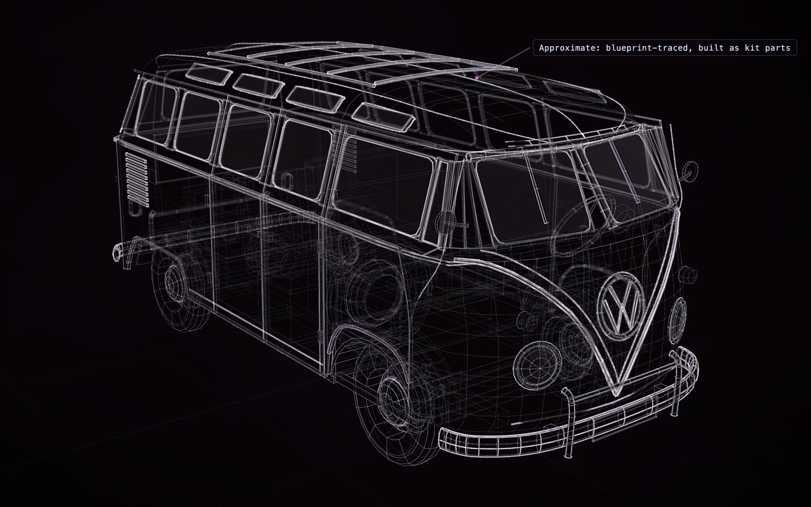

# Volkswagen T1 Samba

[](https://rtmandreyev.github.io/construct/examples/volkswagen-t1-samba/)

**masterpiece · Claude Opus 5.5**

[Open the live construct](https://rtmandreyev.github.io/construct/examples/volkswagen-t1-samba/): drag to orbit, R replays the assembly, L shows
labels. The scene it was built from: [scene.json](scene.json).

As a 1:16 model kit (98 pieces, 48 steps): [in 3D](https://rtmandreyev.github.io/construct/examples/volkswagen-t1-samba/kit/assembly.html) and [its booklet](https://rtmandreyev.github.io/construct/examples/volkswagen-t1-samba/kit/booklet.html). The kit is made from a kit-ready
copy of the construct, [kit-scene.json](kit-scene.json): the same 255 parts, eleven of them moved or reshaped to meet
what they are glued to, as the kit critic asked (the sills reach the sides, the door cards sit on the doors, the
mirror on its vent post, the speedometer pod on the dash), with [kit-plan.json](kit-plan.json) and the paints in
[maps/finish.json](maps/finish.json).

Build it yourself from a checkout of Construct:

```sh
python3 construct_hologram/cli.py build examples/volkswagen-t1-samba/scene.json --out out/volkswagen-t1-samba
```
