# Rain Harbour, a night street

A game level made in Hermes from one concept picture: 60 m of a rain-soaked night street in an invented harbour
district, its towers, its bilingual neon signs and one hero car. 21 constructs, placed 50 times. Each construct was
made in masterpiece rounds by its own builder, a fresh critic judging every round; then the whole world ran 12 rounds
of its own against the picture. Built by GPT-6.1 Sol in Hermes Desktop with the Construct plugin, in about 17 hours, many
constructs building at once. This page follows it from the request to a map in Godot.

<p align="center">
  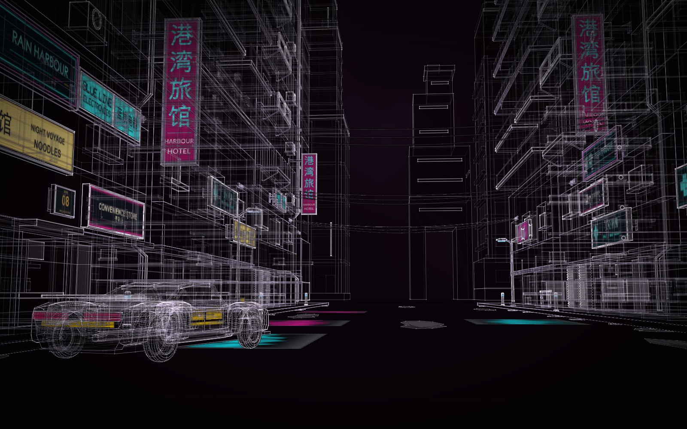
</p>
<p align="center"><sub>From the picture's viewpoint, low down the street. Open the world in Hermes (<b>Worlds</b> on the
Constructs page) or with <code>construct build examples/worlds/rain-harbour/world.json</code>.</sub></p>

<p align="center">
  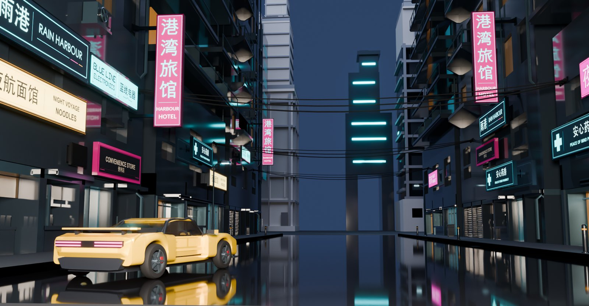
</p>
<p align="center"><sub>The same shot at night in Blender, from the world's export.</sub></p>

## Who it is for

- **Level designers and game developers:** a street block at real size, built from pieces you can reuse, exported
  as one Godot map with the car's doors on their hinges ([Construct for game developers](../../../docs/for/game-developers.md)).
- **Concept artists:** a generated picture turned into a place you can walk round, with real words where the picture
  had letter-noise.
- **Filmmakers:** the four shots the request named are saved views, ready to capture or to finish in Blender.
- **Anyone writing a request like this one:** the run's record shows what a critic catches, what it cannot, and
  where the time goes.

## The ask

One message, with the concept picture attached: an AI-generated picture, made by the requester and published here
with the world.

<p align="center">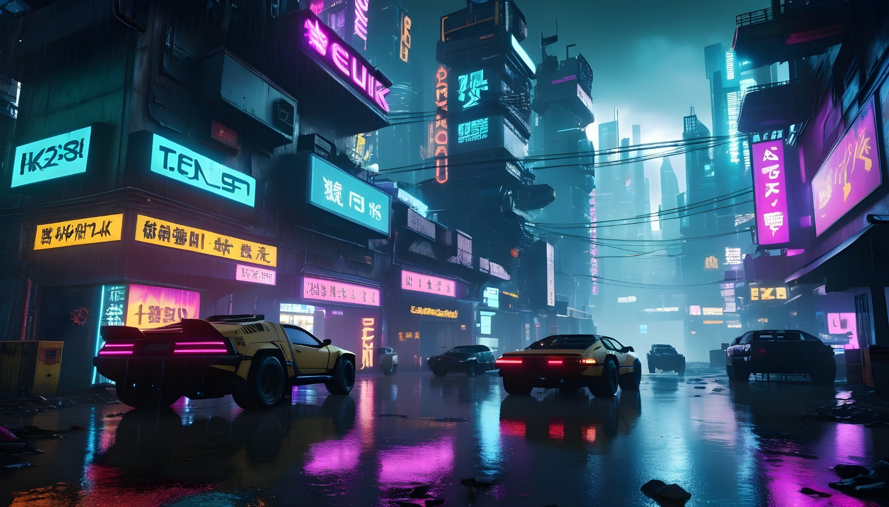</p>
<p align="center"><sub>The concept picture the world was made from. Its signs are AI letter-noise, which the request
asked Construct to replace with real words.</sub></p>

Word for word:

> Make a Construct world from this concept picture: a game level, a rain-soaked cyberpunk street at night.
> Masterpiece quality: it should be usable in a game as it comes out, and good enough to show in a video.
>
> What to build:
> - One street block, about 60 m of street with its pavements, kerbs and drains, the buildings on both sides and
>   the skyline behind them. Real sizes throughout, built as separate pieces a level designer can reuse: a building
>   used twice is one construct placed twice.
> - The buildings are stacked, layered towers with balconies, overhangs, air-conditioning units, pipes and the
>   cables slung across the street between them.
> - The neon signs carry the picture's look, its colours and placement, but every sign must say something real and
>   readable, never the AI letter-noise in the picture. Invent a coherent district and write the signs for it: shop
>   names, a noodle bar, a hotel, a pharmacy, a street number, in English and real Chinese characters that mean what
>   they say. Six to ten different signs.
> - ONE car only: the yellow car in the front left, the hero car. Design it as a real drivable game vehicle, the
>   size of a real sports car, with doors that open, wheels, and its own tail lights. Leave out the three other cars
>   and any people.
> - Street props that make the scene readable: bins, a vending machine, bollards, a street lamp, puddle-level
>   details where they are cheap.
>
> How to make it: plan the pieces first and tell me the plan (how many constructs, which are reused) before
> building. Do not wait for my reply after the plan: state it, then go straight on and build everything. Build each
> missing construct in masterpiece mode in its own subagent, with a critic each round. Then judge the whole world
> against the picture and fix what it finds.
>
> Views for the video: the picture's own shot (low, looking down the street), the hero car close, under the signs,
> and the skyline. Say what is designed and what was inferred from the picture.

Three shorter messages followed, all recorded in the run: one to finish the world under Construct's updated round
rules (below), one when the recorder fixes went live, and one asking for 90 more minutes for the world's rounds.

## The plan

Sol listed what the picture holds and made each distinct thing once, placed as many times as the street needs:

| What | Constructs | Placed |
| --- | ---: | ---: |
| The street: road, pavements, kerbs, drains, wet patches, the ground under it all | 1 | 1 |
| Street-front towers: the Service Tower and the Offset Balcony Hotel | 2 | 10 (five each) |
| Skyline: the Far Signal Tower, the Tide Relay Tower, the Terrace Exchange, the Service Loft | 4 | 5 |
| Signs: six businesses, the district's name and a street number | 8 | 19 |
| AURIC, the hero car | 1 | 1 |
| Props: bollard, street lamp, bin, water vending machine, cable span | 5 | 14 (6 + 2 + 2 + 1 + 3) |
| **In all** | **21** | **50** |

Six of the ten street-front placements line the 60 m block, three a side, facing each other across the road; the
other four stand behind them as nearer layers of the skyline, the same two buildings again. Every placement is at
scale 1. The first pass had 18 constructs placed 48 times; the world's own round 2 added three skyline towers, each
in its own builder.

## Designed and inferred

The district is invented, so nothing here is surveyed. Only one number came from the request, the street's 60 m,
and only that fact is marked as supplied; every other size is a design choice, and each part says so (press **P**).
Inferred from the picture: the street's proportions and spacing, the stacking of the towers, the rhythm of balconies
and overhangs, the low camera, where the car stands and which way it faces, the layered skyline and the cyan,
magenta and amber palette. Designed: the district and its businesses, every sign, the car, the buildings' details,
the props, hidden sides, roofs and interiors.

Sol's first scenes marked several of its own design choices (road width, building heights, the car's size) as
supplied by the person. It found and corrected that before the world's rounds began, changing metadata only.

The chosen sizes, all designed: a 14 m carriageway with 3 m pavements and 0.18 m kerbs; the Service Tower 18 × 12 m
and 48 m high, the Offset Balcony Hotel 18 × 12 m and 62 m, the Tide Relay Tower 84 m, the Terrace Exchange 63.72 m,
the Service Loft 50.7 m, the Far Signal Tower 48 m on a 12 × 10 m footprint with a 6 × 14 m portal through its foot;
AURIC 4.4 m long, 1.95 m wide and 1.25 m high on a 2.8 m wheelbase with 0.34 m wheels; the lamp 4.8 m, the bollard
0.9 m, the bin 1.05 m, the vending machine 1.95 m; the cables span 20 m between the façades.

### The signs

Every sign says something in English and in simplified Chinese that means the same. The artwork was drawn for this
world and each scene marks it as generated decoration, not authentic signage.

| English | Chinese | What the Chinese says |
| --- | --- | --- |
| RAIN HARBOUR, the district fascia | 雨港 | rain (雨) harbour (港) |
| NIGHT VOYAGE NOODLES | 夜航面馆 | night voyage (夜航, sailing by night), noodle restaurant (面馆) |
| HARBOUR HOTEL | 港湾旅馆 | harbour, bay (港湾); inn, hotel (旅馆) |
| BLUE LINE ELECTRONICS | 蓝线电器 | blue line (蓝线), electrical appliances (电器) |
| PEACE OF MIND PHARMACY | 安心药房 | at ease, peace of mind (安心); pharmacy (药房) |
| NIGHT MARKET | 夜市 | night (夜) market (市) |
| CONVENIENCE STORE | 便利店 | convenience store |
| RAIN HARBOUR ROAD 08 | 雨港路 08 | Rain Harbour Road (雨港路), number 08 |

The vending machine adds WATER / 水 and a ¥5 price. Worth knowing: 雨港, "the rain harbour", is also the
long-standing nickname of Keelung, the rainy port city in northern Taiwan. The run does not mention it, and the
district is not Keelung.

<p align="center">
  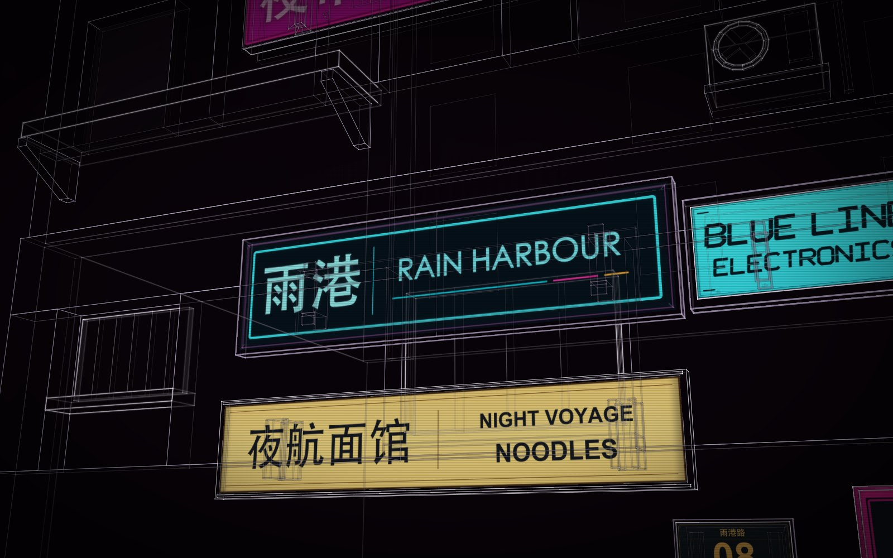
  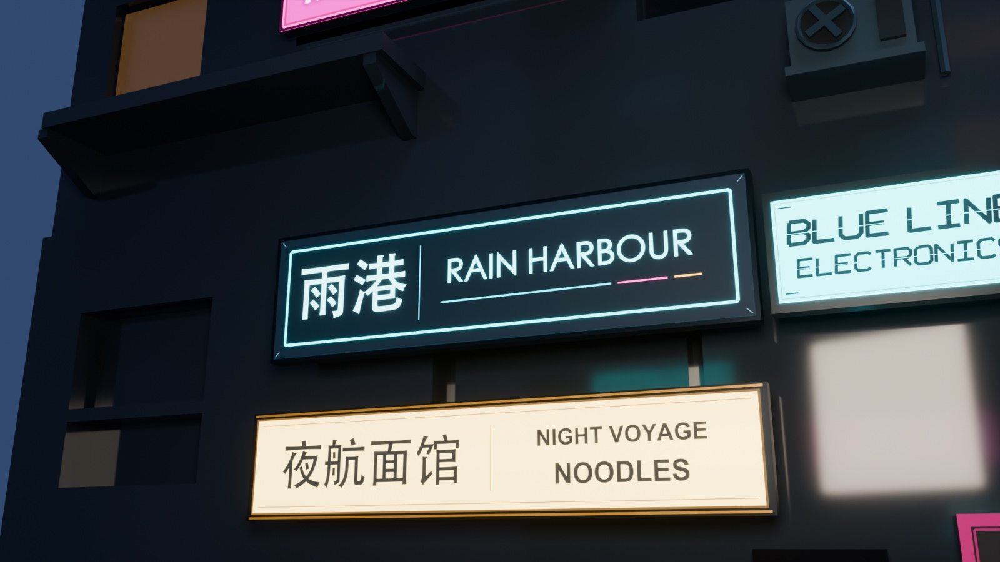
</p>
<p align="center"><sub>Under the signs, in the light view and in Blender.</sub></p>

## The constructs, each in its own builder

Each construct was its own project with its own builder: a scene, a build, a packet of review pictures, a fresh
critic who never saw the authoring, a recorded verdict, the fixes, round after round until a stop rule (12 rounds;
two rounds in a row that do not beat the best; every criterion at 3; two hours of the builder's own time). Signs and
buildings ran up to 12 rounds; the props were capped at four. Several builders ran at once.

| Construct | Folder | Placed | Rounds | Kept | Verdict of the kept round | Stopped by | Builder / critic min |
| --- | --- | ---: | ---: | ---: | --- | --- | --- |
| AURIC, the hero car | `auric` | 1 | 12 | 12 | good, 23 of 27 | the 12-round cap | 33.5 / 51.3 |
| Offset Balcony Hotel | `balcony-hotel` | 5 | 12 | 11 | good, 24 | the 12-round cap | 36.3 / 46.4 |
| Service Tower | `service-tower` | 5 | 12 | 12 | good, 24 | the 12-round cap | 35.1 / 45.9 |
| Service Loft | `service-loft` | 1 | 12 | 12 | good, 23 | the 12-round cap | 19.7 / 48.0 |
| Far Signal Tower | `far-signal-tower` | 2 | 12 | 12 | good, 26 | the 12-round cap | 26.0 / 52.0 |
| Tide Relay Tower | `tide-relay-tower` | 1 | 6 | 4 | good, 25 | two rounds that did not beat round 4 | 7.1 / 18.5 |
| Terrace Exchange | `terrace-exchange` | 1 | 8 | 6 | good, 22 | two rounds that did not beat round 6 | 12.6 / 31.6 |
| The street | `street` | 1 | 7 | 5 | improve, 20 | two rounds that did not beat round 5 | 22.7 / 32.1 |
| RAIN HARBOUR / 雨港 | `sign-rain-harbour` | 2 | 6 | 6 | outstanding, 27 | every criterion at 3 | 6.8 / 18.6 |
| NIGHT VOYAGE NOODLES | `sign-noodles` | 2 | 7 | 5 | good, 26 | two rounds that did not beat round 5 | 9.7 / 27.7 |
| HARBOUR HOTEL | `sign-harbour-hotel` | 3 | 11 | 9 | good, 25 | two rounds that did not beat round 9 | 12.0 / 37.7 |
| BLUE LINE ELECTRONICS | `sign-blue-line-electronics` | 3 | 9 | 7 | good, 26 | two rounds that did not beat round 7 | 12.6 / 29.2 |
| PEACE OF MIND PHARMACY | `sign-pharmacy` | 3 | 10 | 8 | good, 26 | two rounds that did not beat round 8 | 13.2 / 36.7 |
| NIGHT MARKET | `sign-night-market` | 3 | 12 | 10 | good, 25 | two rounds that did not beat round 10 | 16.5 / 46.1 |
| CONVENIENCE STORE | `sign-convenience-store` | 2 | 12 | 11 | good, 26 | the 12-round cap | 16.8 / 45.8 |
| RAIN HARBOUR ROAD 08 | `sign-road-08` | 1 | 8 | 8 | outstanding, 27 | every criterion at 3 | 7.9 / 25.6 |
| Street bin | `street-bin` | 2 | 8 | 7 | good, 25 | the 4-round cap | 9.1 / 26.6 |
| Water vending machine | `water-vending` | 1 | 9 | 7 | good, 24 | two rounds that did not beat round 7 | 11.0 / 32.8 |
| Street lamp | `street-lamp` | 2 | 4 | 4 | good, 23 | the 4-round cap | 4.6 / 14.8 |
| Bollard | `bollard` | 6 | 5 | 4 | improve, 25 | the 4-round cap | 4.7 / 18.8 |
| Cable span | `cable-span` | 3 | 4 | 3 | good, 23 | the 4-round cap | 6.7 / 15.0 |

"Kept" is the round the builder kept as its best; the score is that round's sum over the nine criteria, out of 27.
The minutes are each builder's own active time and its critics' time, as its rounds recorded them. The bin and the
vending machine had run eight and nine rounds before the props' four-round cap was set, and the bollard records a
fifth round past it; the histories were kept as they were rather than rewritten.

What the critics pushed on, in their words:

- **AURIC:** the rear wheel crowns, for twelve rounds. Round 1: "narrow shelves perched over exposed wheels";
  round 12, kept, still: "reads as a folded appliqué".
- **The hotel:** "each floor remains one uninterrupted deck and rail across almost the full stack width"; the room
  doors behind the rails came in, the continuous decks stayed.
- **The Far Signal Tower:** its crown went from "another upright rectangular tier" to "a spike-like crown" and was
  never the "canted futuristic" crown the builder wanted.
- **The street:** the water "reads as five outlined polygon tablets", round after round.
- **The signs:** in the first round of most signs the critic saw no words at all ("Neither RAIN HARBOUR nor 雨港 is
  visible on the actual sign"). After that it was typography ("ordinary contemporary shop typography" for BLUE LINE),
  colour (the noodle bar "muted yellow-ochre … rather than the warm bright amber lightbox") and the brackets behind the
  hotel sign. The night market's round 11 lost because its renders showed no face at all; Construct 1.3 now copies a
  sign's picture into each round's checkpoint, one of the fixes it took from this run.
- **The props:** the bin's lip "reads as a narrow shelf/rail", the vending machine's display "a thin cyan perimeter
  around three pale bottle outlines", the bollard's amber band "almost the same gray as the post".

Two bugs in Construct's rounds recorder paused about eight of these loops early in the first pass: a critic's tie
(`same`) was refused, and so were a critic's extra notes beside its verdict. Both were fixed in Construct before the
world's rounds; the paused loops were resumed from their unchanged answers, at most four builders at a time, and
their new bests were brought into the world.

<p align="center">
  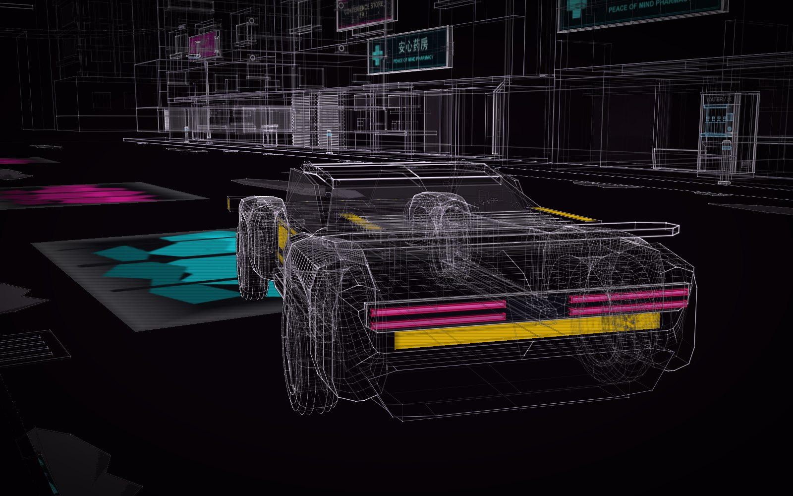
  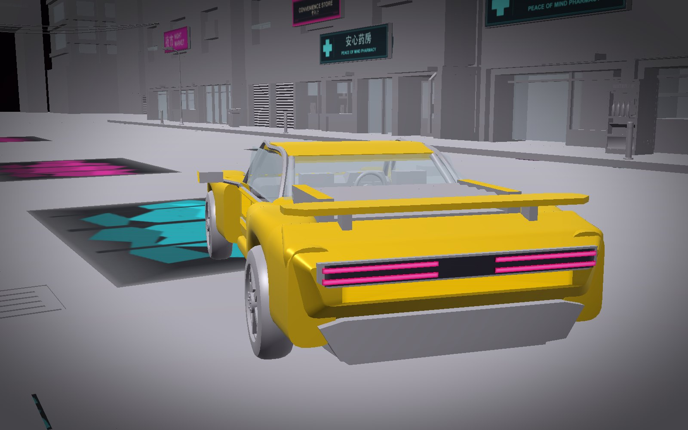
</p>
<p align="center">
  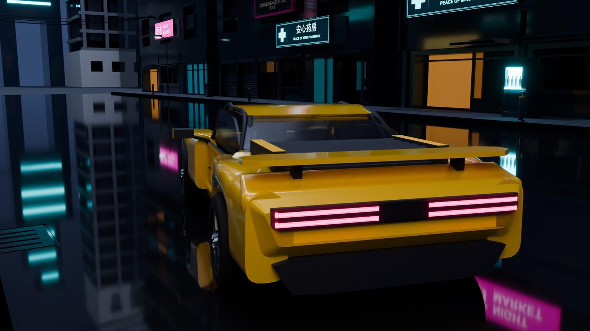
</p>
<p align="center"><sub>AURIC close, in the light view, the solid view (S) and Blender. The light view keeps
Construct's house palette; the car's yellow shows in the solid view and in exports.</sub></p>

### The car

AURIC is an original two-door coupé: 185 named parts, four wheels with tyres, rims, spokes and brakes, magenta tail
lights, a rear wing, two seats, and two gull-wing doors. Each door is a hinge along the roof line (pivot 1.17 m up,
0.59 m either side of the centre line) that lifts 65° and carries 16 parts with it: skin, glass, mirror, lining,
handle, latch. Its builder ran 12 rounds; after the first whole-world review, a second builder made one bounded
repair (rounded quarters, open alloy wheels, thinner door skins, a fuller cabin) judged by one fresh critic,
*improve*; the world's own round 9 painted its body yellow.

## Placed at real size

`construct_world` stood the bollards, lamps, bins and the vending machine on the pavements (0.18 m up), the
buildings along the street with their fronts to it, the signs against their façades at the heights each building
keeps clear for them, the cables between the façades at 7.6 m, and the car on the road by its coordinates, its four
tyres touching y = 0. The world's check passes with six warnings, all the same kind: where a cable's fixing plate
meets a façade. Construct has no wall mount yet, so a cable fixed to a wall touches it.

<p align="center">
  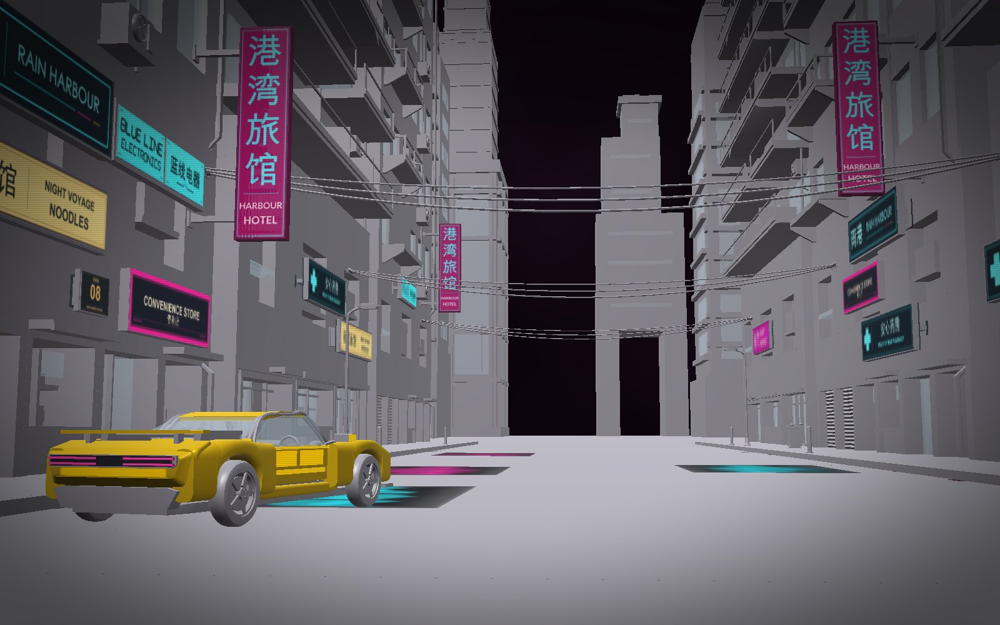
</p>
<p align="center"><sub>The street in the solid view (S): the towers in the house grey, the signs and the car in their
own colours.</sub></p>

## A first pass, and an honest verdict

The first pass, on the morning of 8 November, built 18 constructs, placed them 48 times, and went further than the
request: a playable Godot project, a 20-second film and a development kit (all three below). Two whole-world
reviews judged it against the picture, both *improve*: "a large nearly empty dark road", "very large plain wall
fields", a car with "large flat fender planes". Three builders made one bounded repair each (the Service Tower, the
hotel and the car), and Sol's own README called the result a "playable development delivery, not the requested
masterpiece/reference-quality showcase". The person then asked for the world to be finished under Construct's updated round rules, with the
Godot project, the film and the kit left as they were.

## The world's own rounds

From the evening of 8 November the whole world ran masterpiece rounds against the concept picture: one fresh critic
a round, judging the world's packet (its named views beside the picture) on nine criteria, then the new version
against the best so far without knowing which was which. A round that lost put the world and its constructs back.
At most four builders repaired constructs at once, each in the world's own copy of its construct.

<p align="center">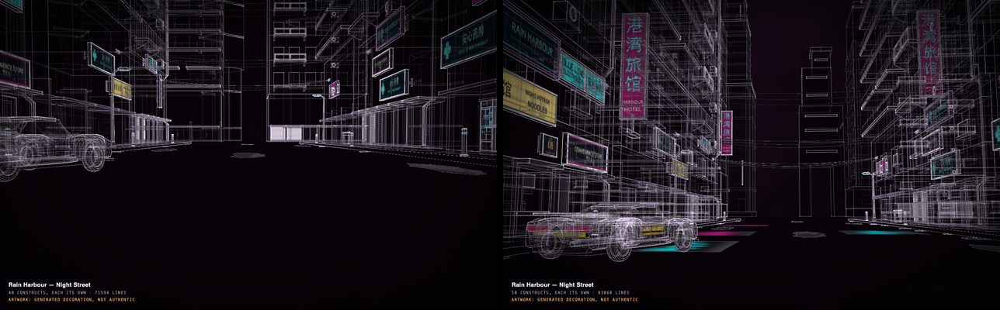</p>
<p align="center"><sub>The view from the picture's viewpoint at round 1 (left) and round 12 (right), from the critics' packets.</sub></p>

| Round | Kept? | What changed | What the critic said next | Verdict, score | Author / critic min |
| --- | --- | --- | --- | --- | --- |
| 1 | baseline | the resumed constructs' bests brought in; 48 placements | the skyline "reads as five isolated thin banded posts with similar needle crowns"; the wet foreground is "a few isolated flat patches" | improve, 17 | 1.7 / 4.4 |
| 2 | kept | three new skyline towers, each built in its own builder; wet patches on the street; the main view reframed so the whole car is in it | "The vanishing point runs straight into the broad center building mass" | improve, 17 | 27.0 / 4.4 |
| 3 | lost, put back | skyline moved apart; larger road accents; recessed shop bays | it "leaves that opening black", where round 2 had a destination | improve, 17 | 20.5 / 5.0 |
| 4 | kept | broad irregular road shapes; the Service Loft moved to the flank; the low view aimed off-centre | "A broad, near-contiguous central slab occupies most of the vanishing-point skyline" | improve, 19 | 22.7 / 4.3 |
| 5 | kept | a sky slot opened at the vanishing point; yellow on the car's flanks; shopfronts with jambs and sills | the centre is "a featureless dark vertical gap"; the near façades are "long straight, similarly spaced apartment walls" | improve, 19 | 23.7 / 4.7 |
| 6 | lost, put back | the Far Signal Tower rebuilt as a 47–49 m stepped tower in the street's sightline | it "puts a broad stepped tower directly in the street opening, with a gate-like void at its base" | improve, 18 | 13.9 / 5.5 |
| 7 | kept | the 48 m stepped tower again, moved off the vanishing point | the car "reads predominantly grey/dark with thin yellow inset strips" | good, 20 | 5.9 / 4.6 |
| 8 | kept | 19 sign close-up views turned to face the signs, not their backs | the picture has "strong large hanging vertical magenta/cyan blades"; a tower stands on "two extremely long bare legs" | improve, 18 | 8.6 / 5.9 |
| 9 | kept | the car painted yellow (judged in the solid view); the hotel sign a 5.4 m double-sided blade; the build order interleaved | the road is "separated reflection cards" | good, 20 | 37.7 / 5.3 |
| 10 | lost, put back | a new massing for the two street-front towers; depth on the Far Signal Tower | the old version "has conspicuously deeper upper-storey balcony/canopy projections" | good, 20 | 23.1 / 4.6 |
| 11 | kept | only round 10's 24-second build order and its closer car view, on round 9's geometry | the walls are "dominated by long, similarly spaced balcony slabs" | good, 21 | 5.2 / 5.3 |
| 12 | kept | shop counters, appliances, stock and extraction in the Service Tower's lower recesses; the bins' hinges and plinths; small pieces on the pavement by the bins | below, under Still open | good, 21 | 14.1 / 5.3 |

<p align="center">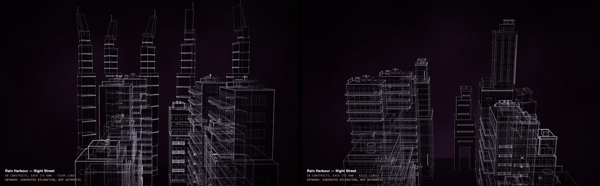</p>
<p align="center"><sub>The skyline at round 1 and round 7: five copies of one 100 m needle became four different towers.</sub></p>

<p align="center">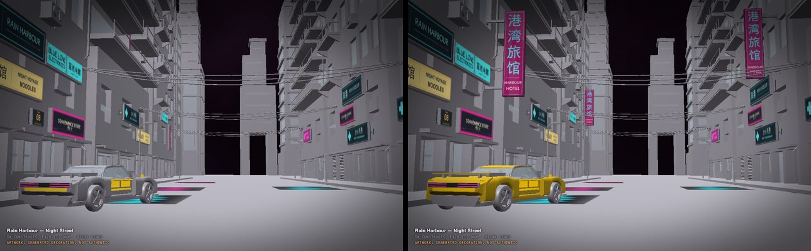</p>
<p align="center"><sub>Round 8 and round 9 in the solid view: the car's yellow on its body, and the hotel's blade signs.</sub></p>

<p align="center">
  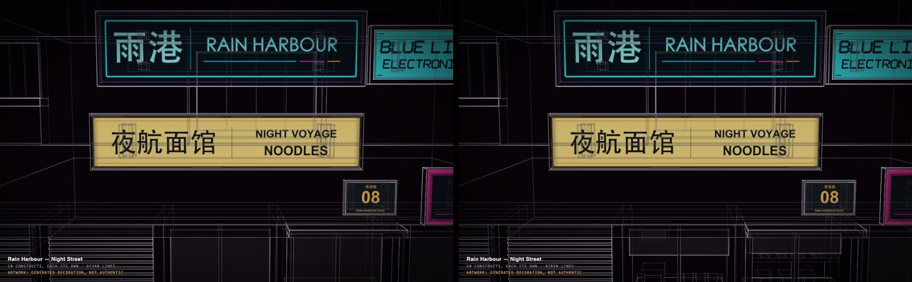
  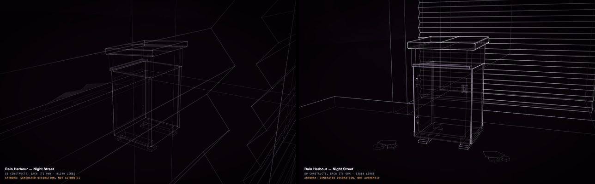
</p>
<p align="center"><sub>Round 12's narrow win: shop fittings under the signs, and the bins' hardware.</sub></p>

Some things to know about these rounds:

- **The time ceiling.** The first eight rounds stopped at the two-hour ceiling on the author's own time (124.1 active
  minutes), with rounds 7 and 8 both winning. The person asked for more time; `rounds extend 90`, which Construct
  gained for this run, raised the ceiling to 210 minutes without resetting the best, the history or the cap, and
  the run went on to the 12-round cap at 204.1 minutes.
- **What the ledger gave up on.** A defect that three kept rounds attempt without progress is retired as a limit of
  the skill. Three were: the wet road (round 5), the skyline's likeness to the picture (round 7) and the empty
  shopfronts (round 12). They are still visible, and the record says so.
- **Colour is judged in the solid view.** The light view keeps Construct's house palette for every construct by
  design. The person said so from round 9 on, and the critics judged the car's yellow in the solid view.
- **Round 12 was a narrow win.** Its critic separated the added shop geometry from a changed inspection camera and
  said the win was "narrow, not a claim that those major remaining mismatches are fixed".

Final verdict: **good**, 21 of 27 (silhouette, proportions, identity, depth, composition and density 2 of 3;
assembly, motion and honesty 3 of 3). Not every criterion reached 3: the run stopped at its cap.

## Still open

What the last critic wrote, kept as it is, so the next person knows where to start:

- the road: "cyan and magenta pools sit inside conspicuous rectangular dark cards separated by a nearly empty
  roadway" (Construct has no wet surface yet);
- the skyline: "a mostly black central void dominated by one isolated stepped tower", where the picture has
  "several overlapping distant towers";
- the signs: "Two similarly tall magenta hotel boards face the foreground on opposite walls", more bilateral and
  evenly spaced than the picture;
- the car: "the conspicuous raised wing, low narrow cabin and exposed-looking rectangular side treatment make it
  read like a stripped track car";
- the shops: "several ground-floor entrances remain a door rectangle plus a long blank counter/awning";
- the towers: "large roof shoulders and distant tower faces remain nearly bare".

The ledger keeps nine open defects (six major, three minor) and the three retired ones, each with its history, in
the run's record; the world's own `authoring` keeps the 12 rounds.

## The numbers

| | |
| --- | --- |
| Constructs, placements | 21, placed 50 times, all at scale 1 |
| Parts | 914 named parts across the 21 scenes; 3,250 copies in the world with every repeat and mirror |
| On the page | 93,868 lines and 116,246 triangles; 27 named views; a 24-second build |
| The check | passes, six warnings (cables meeting façades) |
| The folder | 4.7 MB with its pictures; the built page is about 28 MB |
| The constructs' rounds | 186 rounds in 21 builders: about 325 minutes of builders' own time and 700 of critics', many running at once |
| The world's rounds | 12 rounds: 204.1 minutes of authoring and 59.4 of critics |

## Changed by hand

The level stays yours to change after the run, with no model turn. Opened from the Worlds tab in Hermes Desktop,
**Arrange**: click AURIC, **Turn 90°** twice, the arrow keys to bring it into the middle of the street; click the
cyan-banded signal tower at the end of the street and bring it 30 m closer; **Save** after each. A save checks the
level (the same six cable notes, nothing new), keeps the move in the world's log as the user's, and rebuilds it. In
`world.json` each change is one line: a placement's `at` and `yaw`.

<p align="center">
  
  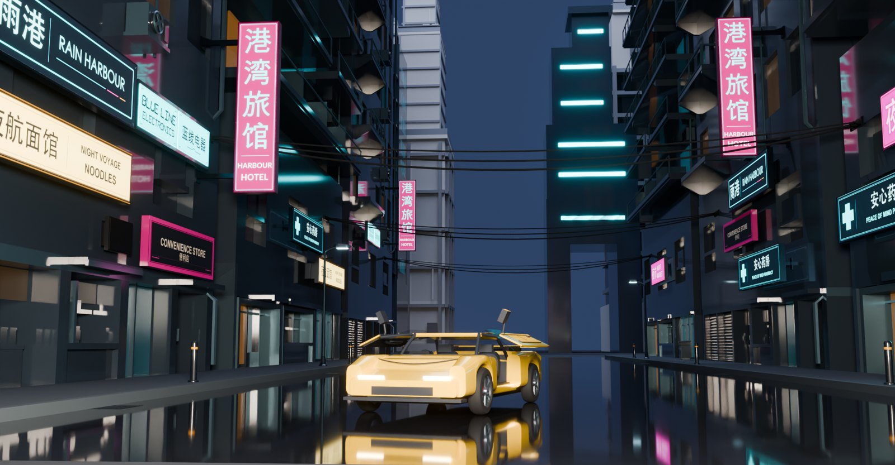
</p>
<p align="center"><sub>Before and after, rendered from the same camera; on the right, AURIC's doors opened on their own
hinges (the export's <code>--pose open</code>).</sub></p>

## Into other tools

**Godot, from Construct itself.** One command makes the world a game map:

```sh
construct export examples/worlds/rain-harbour/world.json --out level.glb --pieces glued
# wrote level.glb: a world of 50 constructs, 2081 parts, 164974 triangles, 120422 edges;
#   animations: open, open:hero-car/left-gullwing-open, open:hero-car/right-gullwing-open
#   artwork: 87 faces, 26 images
```

About 20 seconds on a laptop, a 28 MB file with the signs' artwork in it. Each placement is a group named after it (`hero-car`,
`left-hotel-middle`), every part keeps its name under it, and the street and buildings are the fixed body. The car's
two doors are bodies of their own on their hinges once [`construct_joints.gd`](../../../hosts/godot/construct_joints.gd)
connects them; in the map the hinges carry the doors, so a push or a motor on the hinge opens them. The `open`
animation lifts both in the plain glTF (Blender, or an engine that plays it). The car is drivable by design only: its size, its wheelbase and
its named wheels are a vehicle's, but in the export its wheels are fixed parts of the body. Driving it needs your own
script, as Sol's Godot project did ([Godot](../../../docs/GODOT.md)).

**Sol's Godot project (not shipped).** In the first pass Sol wrote a Godot 4 project around the then-current
exports, and checked it in Godot 4.7.2 (Forward+, Metal):

- **`level.json`** places the 48 placements of the first pass at the positions Construct compiled, including the
  0.18 m pavement height. It shows the first-pass street, not the world on this page.
- **`vehicle.gd`** makes AURIC an arcade car: a `CharacterBody3D` with one box collider (1.94 × 1.06 × 4.3 m), not a
  tyre or suspension simulation. It finds the wheels by their part names, puts each under a steering pivot and a
  spinning pivot, keeps the brake calipers on the knuckles, and plays the exported `open` animation forwards or
  backwards for the doors, only when the car is stopped; it will not drive with the doors open.
- **`main.gd`** builds the night: fog, rain, ripples on the wet patches (`rain_ripples.gdshader`), lights on the
  signs, reflection probes, the four saved views, and binds the sign pictures to their faces (the exporter of the
  time did not carry sign artwork into the glTF).
- **Controls:** W and S drive and reverse, A and D steer, Space brakes, E opens and closes the doors, R resets, F
  follows the car, 1 to 4 the saved views.
- **Its own test** drove 21.9 m, steered 0.75 rad, opened both doors and closed them to their exact pose, found four
  wheel groups, stopped against the kerb, and counted 24 sign faces. A warmed run at 1280 × 720 on an Apple M2 Pro
  averaged 45.4 frames a second (95th percentile 42.8 ms a frame): one sample, not a promise.

Sol also rendered a 20-second, 1920 × 1080 silent film of the four views from that project, and packed a
development kit (18.8 MB, 133 files). Neither is shipped; the person kept them as they were and asked for the world.

**Blender.** Import `world.json` with the [Construct add-on](../../../hosts/blender/README.md), or the exported
`.glb`.

**Films.** The world's named views are the shots the request asked for (the picture's shot, the car close, under
the signs, the skyline): capture them with the viewer or finish them in Blender. Film mode, which assembles a
construct across a track of music, is for single constructs, not worlds.

**A starting point.** Every construct is its own folder under `constructs/`, with its scene and its round record.
Place the hotel, a sign or the car in a level of your own.

## How to write a request like this

What this run shows, for the next request from a picture:

1. **Say what the picture gets wrong.** "Never the AI letter-noise in the picture" turned noise into eight readable
   signs; "leave out the three other cars and any people" held through every round (a critic noted that adding
   the picture's other cars "would violate the brief").
2. **Give the numbers you know, and only those.** One length came from the request and is the only supplied fact.
   Everything else is designed and labelled so; check that the scenes say the same.
3. **Ask for reuse in so many words.** "A building used twice is one construct placed twice" gave 21 constructs for
   50 placements, each reusable alone.
4. **Name the views.** The four shots became the critics' matched views every round, and the film's shots.
5. **Say where colour is judged.** The light view keeps the house palette; say "judge colour in the solid view", or
   a critic may ask for paint the light view will never show.
6. **Say what "drivable" means to you.** A construct is drivable by design: size, wheelbase, named wheels, doors
   on hinges. If you want to drive it, ask for the game project and the controller too.
7. **Budget the time.** Twelve world rounds took 204 minutes of authoring; the default ceiling is 120. Ask for more
   at the start, or extend a stopped run with `rounds extend`.
8. **Know the medium's limits.** A wet road with real reflections is beyond Construct today: three rounds tried and
   the ledger retired it. Make such a thing a wish, not the centre of the request.

## Good to know

- **A designed place.** No real city, survey or vehicle maker is claimed. Press **P**: every part says how it is
  known.
- **Not every criterion at 3.** The world stopped at its 12-round cap with *good*, 21 of 27, and nine open defects.
- **Six contact warnings** where cables meet façades, kept and documented, not hidden.
- **The car's colour** is in the solid view and in exports; the light view shows Construct's house palette.
- **The Godot project, film and kit** were made from the first pass and are not part of this repository.
- **Sign artwork** is generated decoration, marked so in each scene.
- **The coloured patches on the road** are artwork too: the builder painted the signs' reflections onto the wet
  street as cyan, magenta and amber images, because the viewer draws no reflections. In the page they lie flat on the
  road; the Blender and Godot pictures here give the road a glossy wet material instead, which reflects the real
  signs, so the painted patches are not drawn there.

## Credits

Made by GPT-6.1 Sol in Hermes Agent with the Construct plugin, from a concept picture supplied by the requester.
The district, its names and its signs are invented; the sign artwork was drawn for it. Apache-2.0, as the rest of
Construct.
