# Stortorget at Christmas

Stockholm's old square at its Christmas market, made in Hermes from one photograph: the eight houses around it,
researched one by one, the market's stalls, the spruce, the lamp and the granite block in front. It has 13
constructs, placed 53 times (one market stall, 41 times). Each construct was made in masterpiece rounds by its own
builder, with a fresh critic judging every round, and then the whole world ran rounds of its own against the
photograph. It was built by GPT-6.1 Sol in Hermes Desktop with the Construct plugin, in about 20 hours of work over a
day and a night. This page follows it from the request to the houses' colours, and says what is documented and what is not.

<p align="center">
  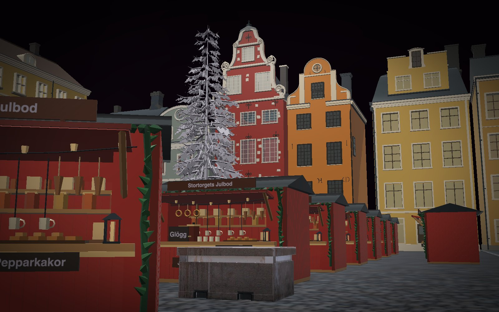
</p>
<p align="center"><sub>From where the photograph was taken, in the solid view (S), each house in its own colours. Open the world in
Hermes (<b>Worlds</b> on the Constructs page) or with <code>construct build examples/worlds/stortorget/world.json</code>.</sub></p>

<p align="center">
  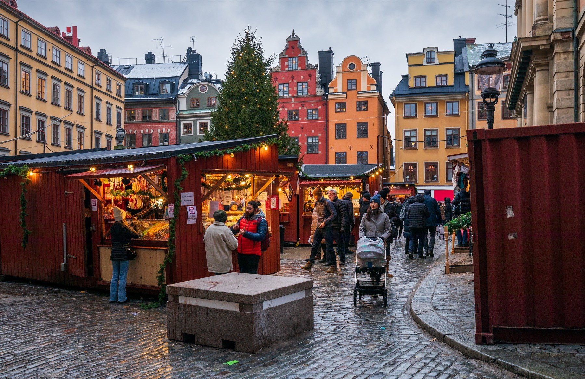
  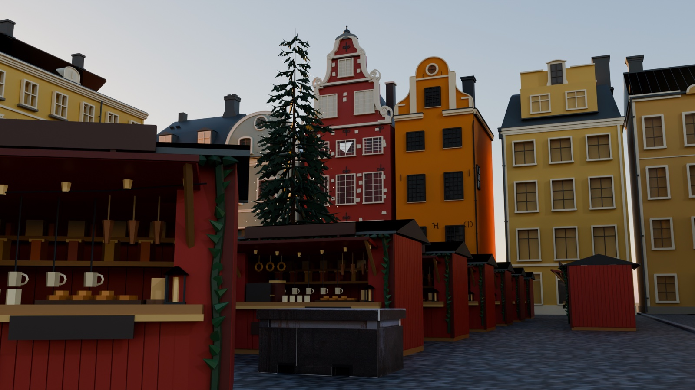
</p>
<p align="center"><sub>Left, the one photograph it was asked from; right, the world from the same place, at dusk in Blender
from the world's export.</sub></p>

Put side by side, the world is close to the photograph: the same gables in the same order and colours, No. 20's
stepped red front beside No. 18's orange curve and its round window, the spruce rising in front of them, the rows of
red stalls running off towards the corner, the granite block, the lamp. All of it came from one photograph and one
request, zero-shot. One picture was a deliberate limit, to show how far one goes. Given photographs from every
side, plans and measurements, each house has more to be checked against, and with tens or hundreds of pictures a
world becomes a digital twin of a place (see [what more pictures give](#what-more-pictures-give)).

## Who it is for

- **Filmmakers and animators:** a real square as a set, with the shots for a short film saved as named views.
- **Teachers, guides and anyone who loves old towns:** the houses of Stortorget with what is known about each of
  them, and what is not, written into the model (press **P**).
- **Game and level designers:** a market square at real size from one stall design placed 41 times, exported as
  one glTF with every placement a named group.
- **Anyone making a world from a photograph:** the run's record shows how far research goes, what a critic catches,
  and one problem a critic could not see.

## The ask

One message, with the photograph attached: Stortorget's Christmas market in December 2022, by Ximonic (Simo
Räsänen), CC BY-SA 4.0 ([on Wikimedia Commons](https://commons.wikimedia.org/wiki/File:Stortorget_in_Gamla_Stan,_Stockholm,_Sweden,_2022_December_-_5.jpg)).

<p align="center"></p>
<p align="center"><sub>The photograph the world was made from: Stortorget, Stockholm, December 2022, by Ximonic (Simo
Räsänen), <a href="https://creativecommons.org/licenses/by-sa/4.0/">CC BY-SA 4.0</a>, unchanged.</sub></p>

Word for word:

> Make a Construct world from this photo: Stortorget, the square in Gamla stan, Stockholm, at its Christmas market
> (December 2022; photo by Ximonic (Simo Räsänen), CC BY-SA 4.0). Masterpiece quality, made to be filmed.
>
> What to build:
> - The houses around the square as they stand: the red stepped-gable house and the orange one beside it
>   (Stortorget 18 and 20), their neighbours, the long yellow building on the left and the corner of Börshuset (the
>   old Stock Exchange, now the Nobel Prize Museum) on the right. Real heights, roofs, gables and window rhythms; use
>   documented facts where they exist and say what you inferred.
> - The square: its cobbles, the kerb, the granite block in front.
> - The Christmas market: the red wooden stalls with their awnings, counters, goods, spruce garlands and strings of
>   warm bulbs (one stall design, placed as many times as the market needs), the big Christmas tree with its lights,
>   the gas lamp on its post. Small objects that make it real: lanterns, crates, a few things on the counters, the
>   stalls' signs in real Swedish (Julmarknad, Glögg, Pepparkakor, a stall's name).
> - Leave out the people, the pram and the red shipping container on the right. No vehicles.
>
> How to make it: plan the pieces, say the plan (how many constructs, which repeat, rough time), then go straight
> on without waiting for my reply. Each new construct in masterpiece mode in its own builder, a fresh critic each
> round, every builder in one project of its own named for this world. Reuse what exists. Then judge the whole world
> against the photo, fix what it finds, and tidy away any scratch projects.
>
> Views for a short film: the photo's own shot, the nearest stall close with its bulbs, the red and orange gables
> from below, the tree, and a high view over the whole square. Say what is documented and what is inferred.

Two later messages each asked for 90 more minutes for the world's rounds.

## The plan

Thirteen constructs, each made once:

| What | Constructs | Placed |
| --- | ---: | ---: |
| The houses: No. 20, No. 18, the sage curved-gable house, the russet mansard house, the long yellow range, the yellow mansard house, the narrow ochre house, Börshuset | 8 | 8 |
| The square: setts, the raised pavement, the curved kerb, the ground under the houses | 1 | 1 |
| The market stall, Stortorgets Julbod | 1 | 41 |
| The Christmas spruce, the post lamp, the granite block | 3 | 3 |
| **In all** | **13** | **53** |

The stall is the one that repeats: a 2022 report counted 41 stalls, so one design stands 41 times, 38 in rows on a
grid of six columns and seven rows with four cells left open, and three more along the east side. Every placement is
at scale 1. No construct in the gallery matched, so all 13 were built new.

## Research: documented and inferred

Each house was researched by its own builder, and each scene cites its sources by link and marks every fact
*verified* (from a source), *user-supplied* (from the request) or *inferred*. The builders cited (more was added
later; see [Provenance, revisited](#provenance-revisited)):

- **Schantzska huset, Stortorget 20 (red).** Its address, and its German–Dutch Renaissance front of 1650 with a
  limestone portal by Johan Wendelstam (reclining Roman warriors), from
  [Swedish Wikipedia](https://sv.wikipedia.org/wiki/Schantzska_huset) and the cultural plaque quoted by
  [Stockholmskällan](https://stockholmskallan.stockholm.se/post/7565) (also: a shared staircase of 1905, renovated in
  1992). Its three bays, of which the tree hides one in the photograph, from the photographs on the website of the
  café on its ground floor (reference only). The pale stones set in its front are 82 in
  [English Wikipedia](https://en.wikipedia.org/wiki/Stortorget) and 94 in Swedish; the scene keeps the conflict and
  asserts neither, and treats the story that they stand for the Stockholm Bloodbath as legend.
- **Seyfridtzska huset, Stortorget 18 (orange).** Its name, from
  [Swedish Wikipedia](https://sv.wikipedia.org/wiki/Seyfridtzska_huset), its number from the
  [café on its ground floor](https://chokladkoppen.se/en/about-chokladkoppen); the same plaque gives three storeys of
  medieval masonry and its present front from the early eighteenth century.
- **Börshuset (now the Nobel Prize Museum).** Its architect, Erik Palmstedt, and its plan, a trapezoid with rounded
  corners, from [English Wikipedia's Stortorget](https://en.wikipedia.org/wiki/Stortorget); its inauguration in 1776
  from [the building's own article](https://en.wikipedia.org/wiki/Stockholm_Stock_Exchange_Building), which lists
  construction to 1778 where the square's article says 1776 (the scene asserts no single completion date); its full
  front from [a 2015 photograph](https://commons.wikimedia.org/wiki/File:Börshuset_January_2015.jpg).
- **The sage curved-gable house.** English Wikipedia places a green No. 22, dated 1758, left of Kåkbrinken; the
  builder found that this does not conclusively identify the gable in the photograph, so the scene calls it
  "No. 22 uncertain".
- **The russet mansard house, the long yellow range, the yellow mansard house, the narrow ochre house.** From the
  photograph only: their windows, dormers and roofs. Their addresses are not established (the yellow mansard house
  is "likely No. 16, not independently established").
- **The market.** 41 stalls from a [2022 report in Mitt i](https://www.mitti.se/nyheter/har-ar-25-julmarknader-i-stockholm-2022-6.19.46228.738bc9a814);
  the market's dates (19 November to 23 December) and its glögg and crafts from a
  [KTH student blog](https://www.kth.se/blogs/studentblog/2022/12/the-stockholm-christmas-market-is-live-now/).

**Inferred:** no reliable published heights of the houses were found, so the request's "real heights" could not be
met, and the run says so rather than inventing them. Every height, footprint, hidden roof and back, the tree's
height, the stalls' size and layout is an estimate from the photograph and is marked so. The estimates: No. 20's
eaves 18 m and apex 28.9 m, No. 18's eaves 17 m, the long yellow range's eaves 18.7 m and ridge 23 m, the yellow
mansard house's eaves 16.5 m, the russet house's 14 m; the spruce 19 m; the stall 2.6 m at the eaves and 3.05 m at
the peak; the lamp 5.1 m; the granite block 1.05 m, its purpose unknown. The square's 96 × 80 m is the ground under
the houses' whole footprints (enlarged from 64 × 60 m during assembly so that Börshuset has ground), not a measured
size of Stortorget.

**Designed:** the stall's name and its goods. "Stortorgets Julbod" means "Stortorget's Christmas stall"; it is an
invented name in real Swedish, not a 2022 vendor. Its other signs are the request's words: *Julmarknad* (Christmas
market), *Glögg* (mulled wine), *Pepparkakor* (ginger biscuits). The paving artwork is generated decoration; the
granite block's surface is cropped from the photograph.

<p align="center">
  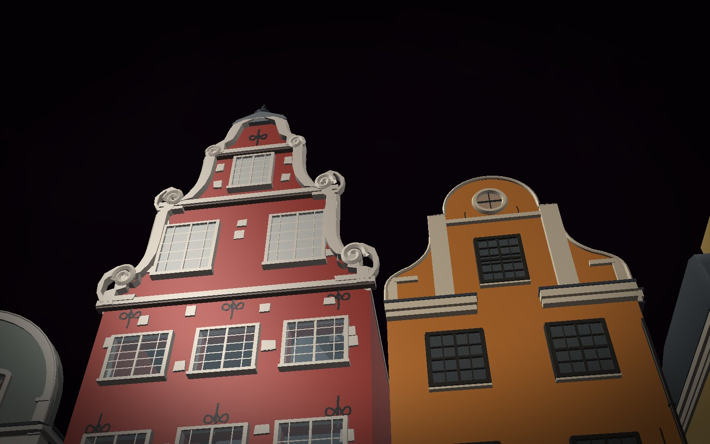
  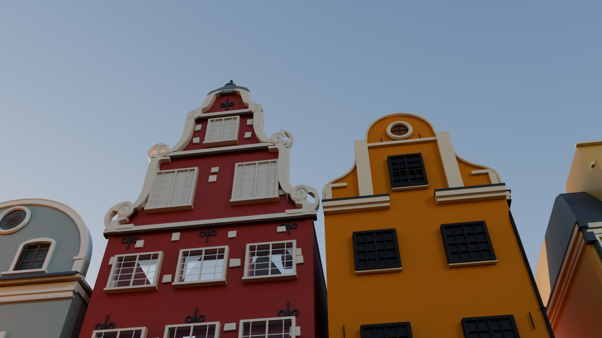
</p>
<p align="center"><sub>The red and orange gables from below, in the solid view and in Blender.</sub></p>

## The constructs, each in its own builder

Each construct was its own project named for this world, with its own builder: a scene, a build, a packet of review
pictures beside the photograph, a fresh critic, a recorded verdict, the fixes, round after round until a stop rule
(12 rounds; two rounds in a row that do not beat the best; two hours of the builder's own time). The lamp and the
block were capped at four rounds. Several builders ran at once.

| Construct | Folder | Placed | Rounds | Kept | Verdict of the kept round | Stopped by | Builder / critic min |
| --- | --- | ---: | ---: | ---: | --- | --- | --- |
| Schantzska huset, No. 20 | `schantzska-huset-no-20` | 1 | 10 | 8 | improve, 20 of 27 | two rounds that did not beat round 8 | 23.0 / 40.0 |
| Seyfridtzska huset, No. 18 | `seyfridtzska-huset-no-18` | 1 | 12 | 12 | improve, 22 | the 12-round cap | 25.8 / 48.2 |
| The sage curved-gable house | `sage-gabled-house` | 1 | 12 | 11 | good, 25 | the 12-round cap | 22.2 / 51.1 |
| The russet mansard house | `russet-mansard-house` | 1 | 9 | 7 | good, 22 | two rounds that did not beat round 7 | 13.6 / 33.5 |
| The long yellow range | `long-yellow-range` | 1 | 12 | 12 | good, 21 | the 12-round cap | 26.9 / 45.3 |
| The yellow mansard house | `yellow-mansard-house` | 1 | 12 | 12 | good, 23 | the 12-round cap | 19.2 / 48.9 |
| The narrow ochre house | `narrow-ochre-house` | 1 | 12 | 11 | good, 23 | the 12-round cap | 15.8 / 43.1 |
| Börshuset | `borshuset` | 1 | 8 | 6 | improve, 21 | two rounds that did not beat round 6 | 32.2 / 33.7 |
| The square | `square` | 1 | 12 | 11 | improve, 20 | the 12-round cap | 43.7 / 58.2 |
| The market stall | `market-stall` | 41 | 6 | 4 | good, 22 | two rounds that did not beat round 4 | 15.8 / 21.7 |
| The Christmas spruce | `christmas-spruce` | 1 | 8 | 8 | improve, 19 | the two-hour ceiling | 140.7 / 28.9 |
| The post lamp | `post-lamp` | 1 | 4 | 4 | good, 22 | the 4-round cap | 4.6 / 12.1 |
| The granite block | `granite-block` | 1 | 4 | 4 | good, 22 | the 4-round cap | 9.4 / 12.8 |

"Kept" is the round the builder kept as its best; the score is that round's sum over the nine criteria, out of 27.
The minutes are each builder's own active time and its critics' time, as its rounds recorded them. The spruce's is
its time at its last round (its clock ran on through repairs after it stopped). The run's own report notes that
the stall's and the block's summaries in their scenes said *improve* where the critic's answer said *good*; the
table gives the answers.

What the critics pushed on, in their words:

- **No. 20:** its first round, "The distinctive sculpted gable is too low and squat relative to its base width"; its
  last, the portal's warriors: "each side is a small head over a polygonal bust … Neither reads as a reclining
  person".
- **No. 18:** "a largely uninterrupted slab with window grids scratched onto it" at first; at round 12 the windows
  still had "almost no dark reveal or readable jamb depth".
- **Börshuset:** "The defining entrance is flattened into the same repeated arched-window pattern as the wings."
- **The narrow ochre house:** its eave semicircle, first "an open horseshoe set in a flat strip of wall", at the end
  "an ornamental horseshoe" where the photograph shows "a plainer filled semicircular patch".
- **The yellow mansard house:** down to centimetres: "The chimney clears the dormer by approximately 0.07 eaves
  widths in still-photo, versus approximately 0.115 in the reference."
- **The stall:** its garlands, "a flat green ribbon and large triangular teeth" at first, "regularly spaced broad
  pointed leaves" at the end.
- **The spruce:** "large empty intervals between exposed primary ribs" at round 1, "isolated paired shelves with black
  horizontal intervals and an exposed central stem" at round 8.
- **The square:** the wet winter surface, from "a dark matte paving print" to "not convincing", twelve rounds on.

<p align="center">
  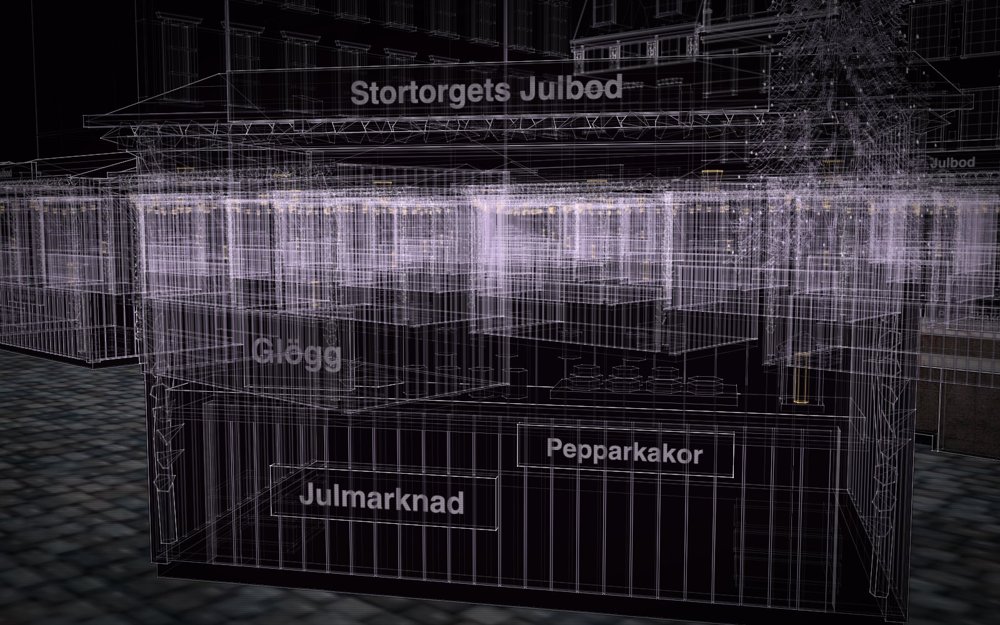
  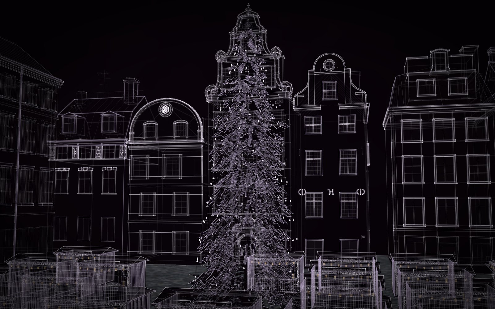
</p>
<p align="center"><sub>The nearest stall with its bulbs, and the tree: two of the five shots the request asked for.</sub></p>

## Provenance, revisited

After the world was finished, every part of it still said *inferred*, and many parts named no source, although each
house had been researched. So GPT-6.1 Sol, the agent that built the world, went back over the ten constructs it had
researched (the eight houses, the lamp and the granite block; the square, the stall and the spruce were left as
they were) and marked what their sources actually establish. It changed no geometry: every size, shape, place,
colour and view is byte for byte what it was. Only the provenance fields differ.

What changed:

- **Every part now names its source**, 1,491 of 1,491 (825 before): a document, a photograph, or, for 355 parts
  hidden or invented to complete a house, the generated modelling estimate it is, said plainly.
- **Facts:** 36 *verified* (9 before), 61 *inferred* (38). The new verified facts are documented statements that are
  not measurements, and each says so: No. 20's four storeys and two attic levels and its three window bays, from the
  [Stadsholmen fact sheet](https://www.stadsholmen.se/app/uploads/2018/09/Echo1-FAKTABLAD.pdf); No. 18's three
  storeys of medieval masonry under five present storeys; Börshuset's construction, inauguration and restoration,
  kept apart rather than merged into one date. Four facts went the other way: two counts read from the photograph
  had been marked *verified*, and two had been marked as given by the request, which never gave them; all four are
  now *inferred*.
- **Sources:** 56 across the ten scenes (31 before), among them a
  [1960 photograph of Stortorget 16–14](https://stockholmskallan.stockholm.se/post/12244) and
  [Börshuset's façade drawing of 1773](https://stockholmskallan.stockholm.se/post/18907) (found and viewed, not
  fitted or measured).
- **How firmly each guess is held**, the shade of amber in the provenance view (**P**), counted over the ten scenes'
  named parts:

| | designed | described | seen | seen and checked |
| --- | ---: | ---: | ---: | ---: |
| Before | 488 | 206 | 794 | 3 |
| After | 15 | 433 | 857 | 186 |

Most guesses are now held more firmly: No. 20's windows and storeys rest on the fact sheet's counts and the
photograph, and show as *seen and checked*. Some are held less firmly than before, where the old link claimed too
much: 104 of Börshuset's parts are now *described* (7 before), most of them *seen* before, and 15 of No. 18's are
plainly designed.

No measured height or footprint was found, so no size became *verified*: the provenance view is still all amber.
The audit also recorded, without repairing them, where the houses differ from their sources: No. 18's documented
shop window and portal against the model's paired café openings, Börshuset's three arched doors against the model's
glazing, and three upper window bays and a central curved eave on the narrow ochre house in the 1960 photograph,
where the model has two bays.

**The critics again.** Construct keeps a critic's verdict only for the exact scene it judged, so changing the scenes
cleared the verdicts in the table above. Each of the ten then had one fresh critic, with no rounds and no repairs,
and its answer was recorded as it came:

| Construct | Verdict | Score | Defects (major / minor) |
| --- | --- | ---: | --- |
| Schantzska huset, No. 20 | improve | 21 of 27 | 5 / 0 |
| Seyfridtzska huset, No. 18 | improve | 21 | 3 / 2 |
| Börshuset | improve | 19 | 5 / 3 |
| The sage curved-gable house | good | 25 | 1 / 1 |
| The russet mansard house | improve | 21 | 4 / 1 |
| The long yellow range | improve | 20 | 3 / 3 |
| The yellow mansard house | good | 22 | 1 / 4 |
| The narrow ochre house | improve | 23 | 1 / 3 |
| The post lamp | good | 23 | 3 / 2 |
| The granite block | good | 22 | 2 / 3 |

The narrow ochre house's critic answered *good* but marked a feature of its checklist missing. Construct recomputes
every verdict from the critic's own answer, and records that one as *improve*. A first pass, made before a correction
to the photograph's source reference, recorded 2 *good* and 8 *improve*: a verdict is one fresh critic's judgement,
and two critics can differ.
The verdicts in the table above are the builders' rounds as they ran; these are the scenes as they ship.

## Placed at real size

`construct_world` placed the houses on the square at their inferred sizes, the back row with No. 20 and No. 18
facing the camera, the long yellow range down the left and Börshuset on the right; the spruce in front of the sage
house and No. 20; the 41 stalls in their rows; the lamp on the raised pavement and the block in the foreground. The
world's check passes with no errors and no warnings: nothing overlaps, nothing floats.

## The world's own rounds

Then the whole world ran masterpiece rounds against the photograph: one fresh critic a round, judging the world's
packet (its named views beside the photograph) on nine criteria, then the new version against the best so far
without knowing which was which. A round that lost put the world and its constructs back. Builders repaired
constructs in the world's own copies, at most four at a time.

The first eight rounds stopped at the two-hour ceiling on the author's own time (127.5 active minutes). The person
asked for 90 more minutes (`rounds extend 90`). Round 9 won, and its packet's captures alone took 26 minutes (failed)
and 35 (succeeded) on a world this large, which used up the extension. A second extension took the ceiling to 300
minutes, and rounds 10 to 12 ran to the 12-round cap (295.6 active minutes in all). Round 11 is the world in this
folder.

<p align="center">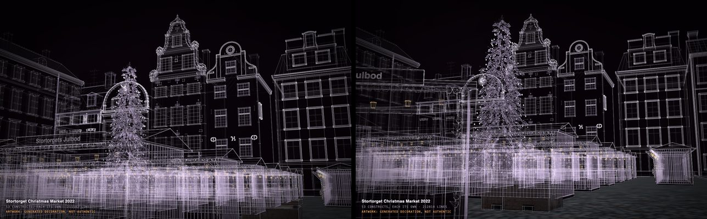</p>
<p align="center"><sub>The photograph's shot at round 1 (left) and round 9 (right), from the critics' packets.</sub></p>

| Round | Kept? | What changed | What the critic said next | Verdict, score | Author / critic min |
| --- | --- | --- | --- | --- | --- |
| 1 | baseline | the five film views and the default shot | "The market is presented as repeated copies of one glögg-and-gingerbread vendor" | improve, 19 | 1.5 / 3.4 |
| 2 | lost, put back | the photograph's foreground; a fuller spruce; stocked shelves | "The alleged matched approach is a wide frontal architectural elevation above a continuous low band of stalls" | improve, 18 | 35.9 / 4.7 |
| 3 | kept | the tree moved forward into an aisle, two stalls moved, the block cleared | "All the architectural facades are neutral gray in the actual solid view" | improve, 18 | 24.3 / 5.0 |
| 4 | kept | the block into the lower centre; the nearest stall brought towards the camera; hanging stock | the tree has "a conspicuous central pole and widely spaced narrow branch tiers" | improve, 18 | 16.1 / 5.8 |
| 5 | kept | the nearest stall shifted to reopen the sage and russet houses; the spruce's foliage interlocked | "The tree is a tall, narrow, skeletal spindle with conspicuous vertical gaps" | improve, 18 | 13.1 / 4.9 |
| 6 | kept | the nearest stall turned so its counter faces the camera; built early in the assembly | the shot "is not the source composition" | improve, 19 | 10.1 / 5.4 |
| 7 | kept | the stall close-up reframed so its name reads whole; Börshuset's blank ends given plinths and cornices | the façades "almost uniformly grey in the actual colour view" | improve, 18 | 14.8 / 4.9 |
| 8 | kept | a steeper high view over the whole market | "red No20, orange No18 and colored neighboring range become uniformly pale gray" | improve, 19 | 11.7 / 5.1 |
| 9 | kept | the eight houses given their own colours | the tree's "separated angular skirts and large open gaps" | good, 21 | 95.9 / 6.3 |
| 10 | kept | the lamp's own view shows its one lantern whole; the sage and russet houses raised towards the photograph's roofline (18.5 to 20.7 m, 23.6 to 26.0 m) | "The tree foliage is pale grey in the actual SOLID image" | good, 22 | 39.8 / 4.1 |
| 11 | kept | No. 18's crown raised against No. 20's (22.6 to 24.1 m) | "The actual SOLID tree is pale grey rather than the deep green spruce" | **improve, 19** | 25.4 / 5.1 |
| 12 | tied, put back | the long range's bare end walls given cornice and band returns | the same pale tree; "separated thin branch tiers" | good, 21 | 7.0 / 4.4 |

Round 9's 95.9 minutes include the two long captures. Each round is decided by the critic comparing the new version
with the best so far, not by the scores, so round 11 won against round 10 while scoring lower: the critic preferred
No. 18's taller crown in the photograph's shot. Rounds 10 and 11 also tried to make the spruce darker and fuller,
twice. On a tree of 7,700 parts the edit timed out each time and the tree stayed as it was, which is why the last
three critics still saw it grey. In the exports and in Blender it is green: a finish map beside it
(`constructs/christmas-spruce/scene.materials.json`) gives its needles, trunk and lights their materials. Round 1's packet left out the request and the photograph by
mistake; its judgement was kept, and every later packet carried both. The first critic's complaint about one vendor
repeated was set aside as the request's own choice (one stall design). The photograph's low approach, attempted in
three kept rounds without the critic's agreement, was retired as a limit of the skill after round 8.

<p align="center">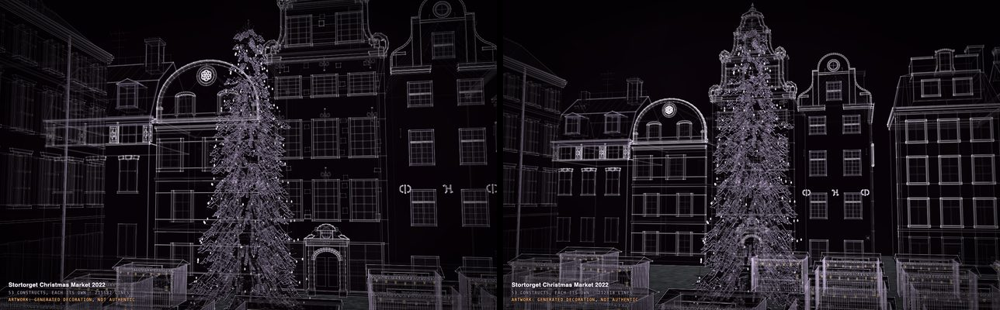</p>
<p align="center"><sub>The tree at round 1 and round 9: taller and further forward, still in separate tiers.</sub></p>

### The houses' colours

From round 2 to round 8 every critic said the same thing: in the solid view the houses were grey, while the stalls
were red and green. The critics were right. The stall's builder had given its parts colours of their own from the
start. The eight houses' builders had not, so the solid view drew them in Construct's neutral grey. In round 9 one
repair builder gave the houses their colours (`look.color` on every part of the eight houses, nothing else changed):
red for No. 20, orange for No. 18, yellow and ochre for the long range, the yellow mansard house and the narrow
house, sage, russet, and pale stone for Börshuset. The round-9 critic saw them ("No20 is red, No18 orange and the
right mansard and left range yellow") and the world won its first *good*.

<p align="center">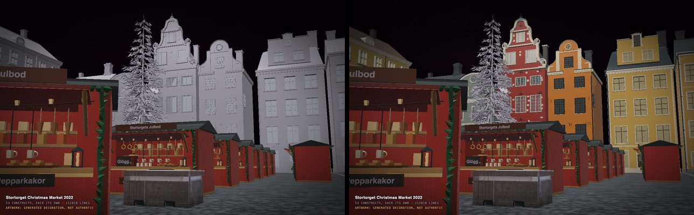</p>
<p align="center"><sub>The solid view at round 8 (left) and round 9 (right).</sub></p>

A second problem was hidden behind the first, and it was Construct's. The viewer kept one texture row for each
style, and this world has about 15,600 styles: taller than software WebGL (8,192 rows) and some GPUs allow. There
the upload failed and the solid view drew every own colour black or grey, whatever the scene said. It was found in
this run, after round 9, and fixed in Construct 1.3: records now sit 256 to a texture row, so a big world keeps its
colours on every GPU. The critics' captures were not affected (the stalls kept their red throughout), so the round
table stands as recorded.

Final verdict, round 11 kept: **improve**, 19 of 27 (silhouette, proportions, depth and density 2 of 3; identity
and composition 1, both for the grey tree and the photograph's shot; assembly, motion and honesty 3 of 3). Round 9's
critic had said *good*, 21; round 10's, *good*, 22.

## Still open

What the last critics wrote (rounds 11 and 12, both against round 11), so the next person knows where to start:

- the tree: its crown "reads as separated thin branch tiers with conspicuous empty intervals", too "narrow and
  spire-like" in its upper half, and its foliage pale grey in the solid view (green in exports, by its map);
- the photograph's shot: the block's top sits near 79 percent of the frame's height where the photograph has it near
  72, "an oversized cropped left stall plus straight recession dominate", and the right-hand buildings are mostly
  outside the frame;
- the roofline: "The sage crown and adjacent mansard sit substantially farther below No20's summit than in the
  reference";
- the stall's stock: "a few large bags, ring shapes, cups and flat stacks with substantial empty backboard";
- the backs: "large minimally articulated end walls and broad roof planes", a "detailed facade set around simpler
  boxes".

Fixed in rounds 10 and 11, and closed in the ledger: the lamp's view, the curved kerb in the foreground, the
assembly's later stages and No. 20's height over No. 18. The ledger keeps seven open defects and four known limits,
each with its history, in the run's record.

## The numbers

| | |
| --- | --- |
| Constructs, placements | 13, placed 53 times, all at scale 1; one stall 41 times |
| Parts | 2,790 named parts across the 13 scenes; 15,531 copies in the world with every repeat; 7,710 named parts in its glTF |
| On the page | 212,818 lines and 273,912 triangles; 165 labels; seven named views; an 18-second build |
| The check | passes, no warnings |
| The folder | 9.5 MB with its pictures; the built page is about 65 MB |
| The constructs' rounds | 121 rounds in 13 builders: about 390 minutes of builders' own time and 480 of critics', many running at once |
| The world's rounds, 1 to 12 | 295.6 minutes of authoring (including captures) and 59.1 of critics |

## Into other tools

**Films.** Six of the world's seven named views are the shots the request asked for: *Photo approach* (and its
alias *hero*), *Nearest stall*, *Both gables from below*, *Christmas spruce* and *High view*; the seventh, *Single
lamp*, was added in round 10 to show the lamp whole. Capture them with the viewer, or
finish them in Blender. Film mode, which assembles a construct across a track of music, is for single constructs,
not worlds.

**Blender and other tools.** One glTF, each placement a named group:

```sh
construct export examples/worlds/stortorget/world.json --out stortorget.glb
# wrote stortorget.glb: a world of 53 constructs, 7710 parts, 278048 triangles, 213560 edges; animations: none
```

About 14 seconds on a laptop, a 36 MB file. The houses' colours travel with it. Or import `world.json` with the
[Construct add-on](../../../hosts/blender/README.md).

<p align="center">
  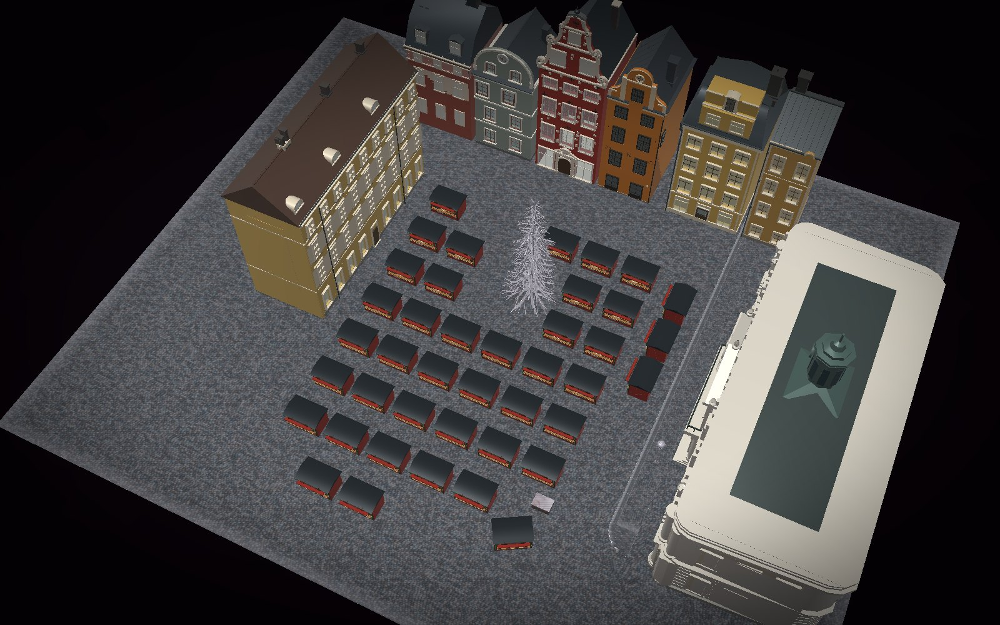
  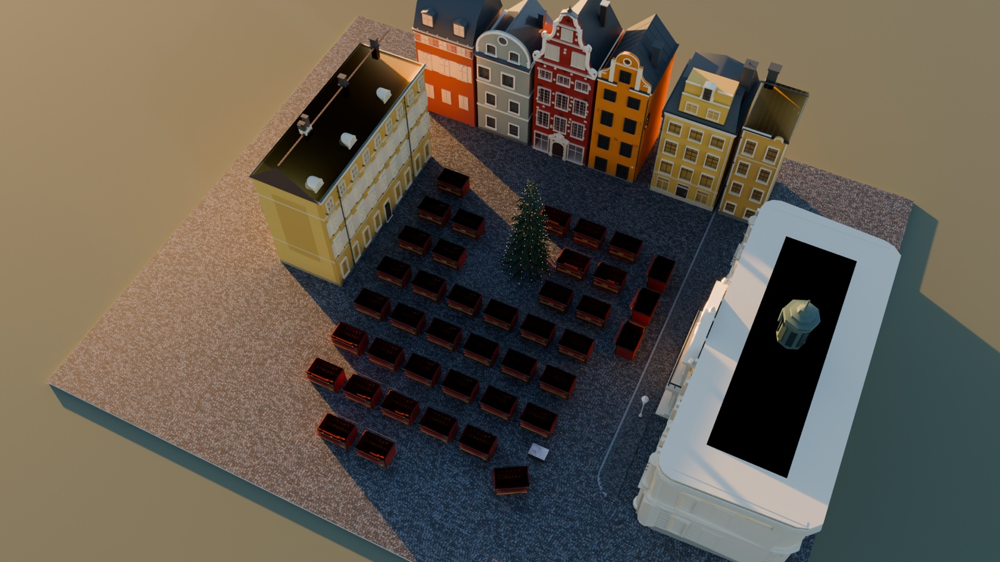
</p>
<p align="center">
  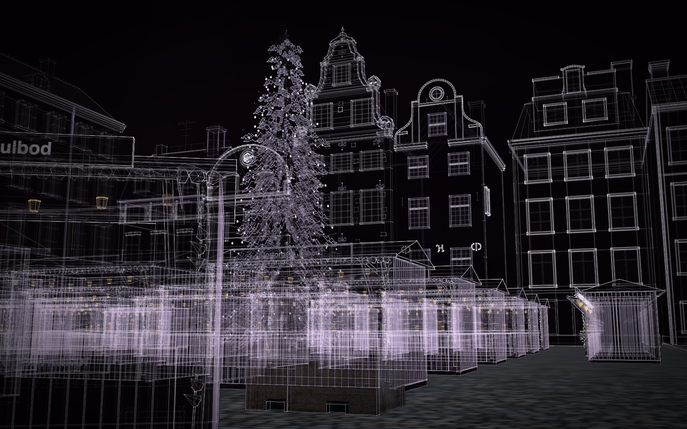
</p>
<p align="center"><sub>The high view in the solid view and in Blender, and the photograph's shot in the light view,
which keeps Construct's house palette.</sub></p>

**A starting point.** Every construct is its own folder under `constructs/`, with its scene, its sources and its
round record. Place the stall in a market of your own, or one of the houses in another square.

## How to write a request like this

What this run shows, for the next world from a photograph:

1. **Give the photograph's credit and licence in the request.** Sol carried them into every scene and the world.
2. **Ask for documented and inferred, and accept "not found".** The request asked for real heights; none were
   published, and the run said so instead of inventing them. That is the answer to want.
3. **Name the houses you know,** with their numbers (Stortorget 18 and 20). The builders found their sources from
   the names; the unnamed neighbours stayed "from the photograph only".
4. **Ask for colours from the start.** "Paint each house in its own colours, checked in the solid view" would have
   saved seven rounds of the same complaint. The light view keeps the house palette by design.
5. **Say whether repetition is wanted.** "One stall design" is efficient and was kept; the first critic read it as
   "one glögg-and-gingerbread vendor". If you want variety, ask for it: trader signs, goods, colours.
6. **Name the shots.** The five views became the critics' matched views and the shots for a film.
7. **Budget for size.** A world of 15,000 copies takes half an hour to capture a packet; two hours do not go far.
   Ask for more time at the start, or extend a stopped run with `rounds extend`.
8. **Leave things out by name.** "Leave out the people, the pram and the red shipping container" held through every
   round, and no critic penalised their absence.

## What more pictures give

This world had one photograph on purpose. Most of what the provenance view (**P**) marks as inferred is inferred
because one picture cannot show it: the backs of the houses, the far side of the square, true heights, the market's
layout beyond the frame. Each kind of picture removes a kind of guess:

- **Photographs from every side** fix the backs and ends that were "large minimally articulated end walls" here;
- **a plan or a map** fixes the square's outline and the houses' footprints;
- **elevations, old postcards or archive drawings** fix heights, windows and details that change over time;
- **a few measurements** (a door, a storey) turn proportions into sizes the audit can hold.

With tens or hundreds of pictures of one place, a world becomes a digital twin of it, and every construct in it
stays separate: a heritage site recorded house by house with what is known about each, a street as a set for a
film's previsualisation, a campus, a shop floor or a hall to plan a change in, a real neighbourhood as a game level.

## Good to know

- **Not a survey.** The houses' identities and histories are documented; their sizes are not. Press **P**: every
  part says how it is known.
- **The layout of the market is inferred.** The photograph shows a corner of it; the count of 41 is documented.
- **The colours are in the solid view and in exports;** the light view keeps Construct's house palette.
- **The verdict is *improve*.** Two critics called it *good* (rounds 9 and 10); the last kept round's critic did not,
  mostly for the grey tree in the solid view. What is still open is listed above.
- **No people, no vendors, no vehicles,** as asked.

## Credits

Made by GPT-6.1 Sol in Hermes Agent with the Construct plugin, after a photograph by Ximonic (Simo Räsänen),
CC BY-SA 4.0, included unchanged as `reference.jpg` under that licence. Sources for the houses are cited in each construct's scene. The stall's name is
invented, in real Swedish. **Licence:** the world was made to match a CC BY-SA 4.0
photograph, so this folder (the world, its constructs, its pictures and this page) is under
[CC BY-SA 4.0](https://creativecommons.org/licenses/by-sa/4.0/) with the credit above, apart from the rest of
Construct (Apache-2.0); see its [LICENSE](LICENSE).
