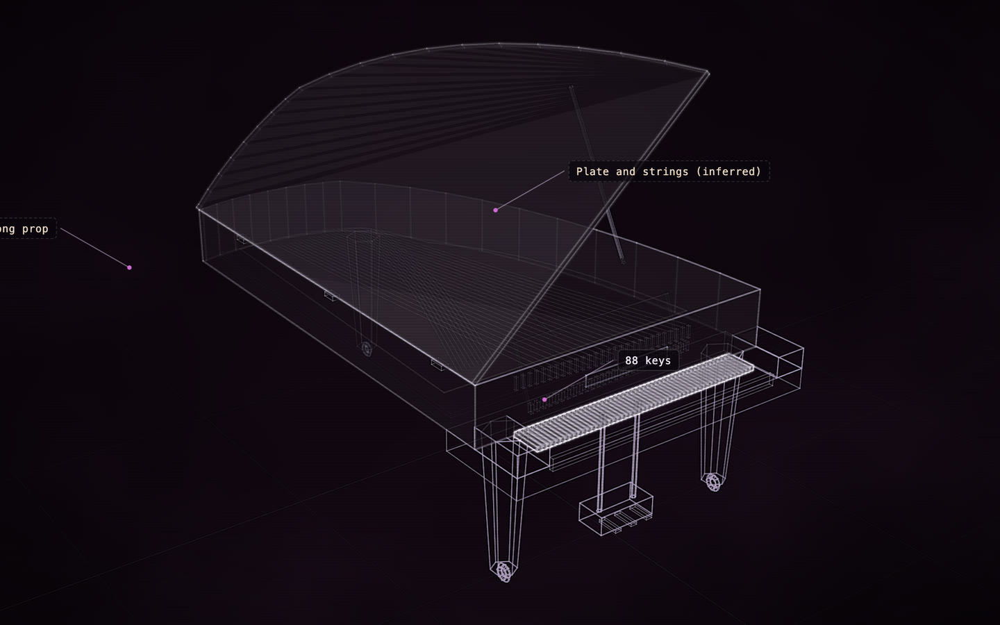

# Yamaha CFX

[](https://rtmandreyev.github.io/construct/examples/yamaha-cfx/)

**fast · DeepSeek V4.1 Flash**

[Open the live construct](https://rtmandreyev.github.io/construct/examples/yamaha-cfx/): drag to orbit, R replays the assembly, L shows
labels. The scene it was built from: [scene.json](scene.json).

Build it yourself from a checkout of Construct:

```sh
python3 construct_hologram/cli.py build examples/yamaha-cfx/scene.json --out out/yamaha-cfx
```
